# Guía de ensamblaje · robot FT412

**Edición 3 · instrucciones de mesa · 16 de noviembre de 2026.** Montaje FramingTech 355/250 con Adafruit 412.

[Descargar el manual ilustrado en PDF](/downloads/guia-ensamblaje-ft412-es.pdf) · [Empezar: piezas del marco](#paso-01-separar-los-perfiles-y-las-escuadras) · [Cargar las tuercas antes de cerrar](#paso-02-cargar-las-tuercas-de-entrada-por-el-extremo)

Cada paso empieza con **lo que necesitás**, seguido de la preparación previa, una ilustración, acciones numeradas y el resultado que debés comprobar. Una pieza que dice «ya colocada» se reutiliza: no saqués otra de la bolsa.

**Primero las tuercas, después las uniones.** Las SQN05M4 cuadradas del kit GS20 entran por el extremo de los perfiles. Las RN05BM3 y RN05BM5 son tuercas de entrada lateral. Las tuercas cuadradas pequeñas para alojamientos impresos son una tercera familia. No son intercambiables.

Miramos desde el frente, por donde se coloca el teléfono: los motores quedan al fondo. Izquierda y derecha mantienen esa orientación en todo el manual. En los dibujos: gris es aluminio o herraje, verde es pieza impresa y naranja destaca la pieza que se coloca. Los dibujos de herrajes son esquemas, no plantillas para fabricar o perforar.

Las 22 piezas impresas están terminadas según el dueño. Sus encajes todavía se comprueban al montar. Trabajá con fuente y USB desconectados y sin teléfono. Las medidas son nominales del proyecto: cotejalas con tus piezas. El cableado y el encendido están separados del armado mecánico al final de esta guía.

## Paso 01. Separar los perfiles y las escuadras

**Necesitás para este paso**

| Pieza o herraje | Cant. | Uso en este paso |
|---|---:|---|
| Perfil grueso 20×40, largo 355 mm | 2 | Costados izquierdo y derecho |
| Perfil grueso 20×40, largo 190 mm | 2 | Frente y fondo |
| Perfil delgado 10×20, largo 190 mm | 2 | Travesaños de la cama |
| Perfil delgado 10×20, largo 185 mm | 1 | Puente móvil; reservar |
| Kit de escuadra GS20-05W | 8 | 4 esquinas + 4 apoyos de cama |
| Tornillo M4×8 LHCS del kit | 16 | 2 por escuadra |
| Tuerca SQN05M4 del kit | 16 | 2 por escuadra; entrada por extremo |

**Herramientas:** regla o calibre, cinta para etiquetas y recipientes.

**Antes de montar:** No juntés todavía los extremos. Necesitamos que las ranuras sigan abiertas para cargar las tuercas.

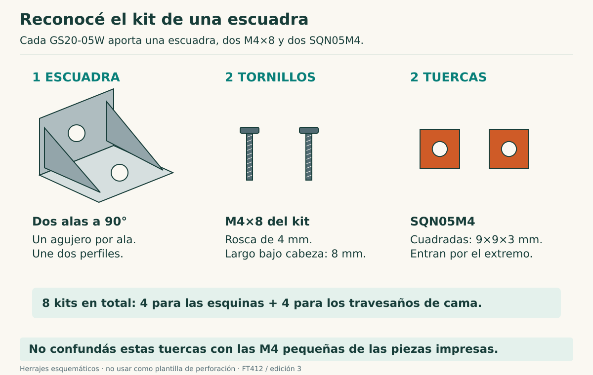

1. Medí y etiquetá los siete perfiles. Los de 190 mm gruesos y delgados tienen la misma longitud, pero usos diferentes.
2. Separá cuatro escuadras para el marco y otras cuatro para la cama. Cada escuadra debe tener sus dos M4×8 y dos SQN05M4.
3. Identificá la SQN05M4 por su cuerpo cuadrado de 9×9×3 mm. No la mezclés con las pequeñas tuercas M4 de las piezas impresas.
4. Reservá el perfil de 185 mm. En el paso siguiente cargamos las tuercas en los otros seis perfiles.

**Comprobá antes de seguir:** tenés 7 perfiles identificados, 8 escuadras, 16 tornillos y 16 tuercas del kit.

## Paso 02. Cargar las tuercas de entrada por el extremo

**Necesitás para este paso**

| Pieza o herraje | Cant. | Uso en este paso |
|---|---:|---|
| Costados 355 mm | 2 | 4 SQN05M4 en cada uno |
| Extremos gruesos 190 mm | 2 | 2 SQN05M4 en cada uno |
| Travesaños delgados 190 mm | 2 | 2 SQN05M4 en cada uno |
| SQN05M4 del paso 01 | 16 | 8 costados + 4 extremos + 4 travesaños |

**Herramientas:** regla y cinta removible para evitar que las tuercas se salgan.

**Antes de montar:** Apoyá los perfiles gruesos con 40 mm en vertical. En cada costado elegí la cara que mirará al interior del rectángulo y, en ella, la ranura inferior.

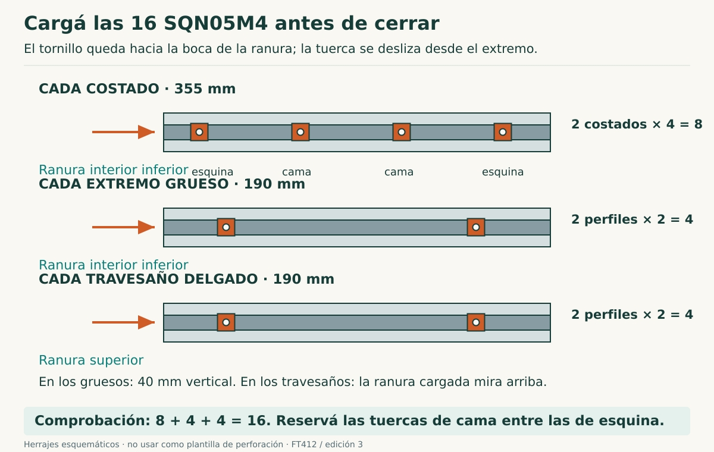

1. Deslizá 4 SQN05M4 desde un extremo dentro de la ranura interior inferior de CADA costado de 355 mm. El agujero roscado mira hacia la boca de la ranura.
2. Ordenalas de frente a fondo: esquina delantera, travesaño delantero, travesaño trasero, esquina trasera. Las dos centrales se reservan para la cama; no las gastés en las esquinas.
3. Cargá 2 SQN05M4 en la ranura interior inferior de CADA extremo grueso de 190 mm: una para cada esquina.
4. Cargá 2 SQN05M4 en la ranura que quedará hacia ARRIBA de CADA travesaño delgado de 190 mm. Quedará una cerca de cada extremo. Reservá estos perfiles para el paso 06.
5. Contá las 16 dentro de sus ranuras. Sujetá provisionalmente las salidas con cinta si se deslizan fuera al manipular.

**Comprobá antes de seguir:** 4 + 4 + 2 + 2 + 2 + 2 = 16 tuercas cargadas. Ninguna SQN05M4 pendiente de introducir con el perfil ya encerrado.

**Detalle importante:** FramingTech especifica entrada por el extremo para SQN05M4. No se mete de frente por la boca de 5 mm ni se convierte en una tuerca de giro.

## Paso 03. Unir las cuatro esquinas del marco

**Necesitás para este paso**

| Pieza o herraje | Cant. | Uso en este paso |
|---|---:|---|
| Perfiles gruesos precargados | 4 | 2 largos y 2 cortos |
| Escuadra GS20-05W | 4 | Una en cada esquina interior |
| M4×8 LHCS | 8 | Dos por escuadra |
| SQN05M4 ya cargadas | 8 | 4 de los costados + 4 de los extremos |

**Herramientas:** llave Allen de 3 mm del herraje, mesa plana y escuadra.

**Antes de montar:** Dejá libres las dos tuercas centrales de cada costado: son para la cama. Mirá el corte del dibujo: el tornillo atraviesa el ala de la escuadra y entra en la tuerca que está DENTRO del perfil.

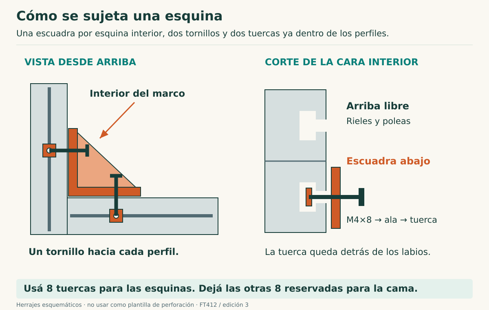

1. Poné los dos costados de 355 mm paralelos. Colocá los dos extremos gruesos de 190 mm ENTRE los costados, al ras del frente y fondo.
2. Acercá la primera escuadra a una esquina interior, dentro de los 20 mm inferiores. Sus dos alas apoyan en caras perpendiculares, una en cada perfil.
3. Deslizá las dos tuercas de esa esquina hasta alinearlas con los agujeros de la escuadra. Pasá un M4×8 por cada ala y enroscalo a mano en su tuerca.
4. Repetí en las otras tres esquinas. Dejá las ocho fijaciones apenas asentadas para poder escuadrar. La zona superior queda libre para rieles y poleas.

**Comprobá antes de seguir:** hay 4 escuadras visibles dentro del marco y 8 tornillos iniciados. Quedan 2 SQN05M4 libres en cada costado para los travesaños.

**Detalle importante:** Esta variante se une con escuadras: no necesita los agujeros ni los M6 del marco original del video.

## Paso 04. Escuadrar y apretar el marco

**Necesitás para este paso**

| Pieza o herraje | Cant. | Uso en este paso |
|---|---:|---|
| Marco del paso 03 | 1 | Incluye sus 4 escuadras y 8 fijaciones; nada nuevo |

**Herramientas:** regla larga o cinta de medir, escuadra y Allen de 3 mm.

**Antes de montar:** Apoyá las cuatro esquinas sobre la misma mesa plana. Todavía deben poder ajustarse.

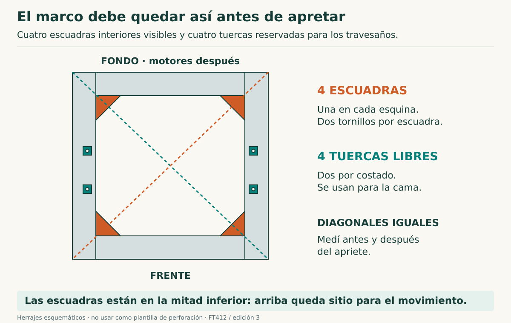

1. Acercá las caras de unión hasta que no haya separación visible entre perfiles.
2. Medí las dos diagonales entre los mismos puntos exteriores: delantera izquierda a trasera derecha y delantera derecha a trasera izquierda.
3. Ajustá el rectángulo hasta que ambas medidas coincidan dentro de la resolución de tu regla. Comprobá también las esquinas con la escuadra.
4. Apretá progresivamente, alternando esquinas. Volvé a medir las dos diagonales después del apriete y verificá que no se balancee.

**Comprobá antes de seguir:** rectángulo nominal de 230×355 mm, plano y con diagonales iguales. Las cuatro tuercas reservadas para la cama siguen accesibles.

## Paso 05. Montar las cuatro patas

**Necesitás para este paso**

| Pieza o herraje | Cant. | Uso en este paso |
|---|---:|---|
| Marco escuadrado | 1 | Apoyarlo sin rayar el aluminio |
| Pata impresa | 4 | Una por esquina |
| BHCS M5×16 | 4 | Desde abajo a través de cada pata |
| RN05BM5 de entrada lateral | 4 | Ranura inferior de los costados |
| EVA de 1 mm | 4 | Almohadillas para las bases |

**Herramientas:** Allen de 3 mm, regla y tijeras para la EVA.

**Antes de montar:** Estas RN05BM5 pueden entrar por la abertura de la ranura. No uses aquí las SQN05M4 reservadas ni las tuercas cuadradas de los alojamientos impresos.

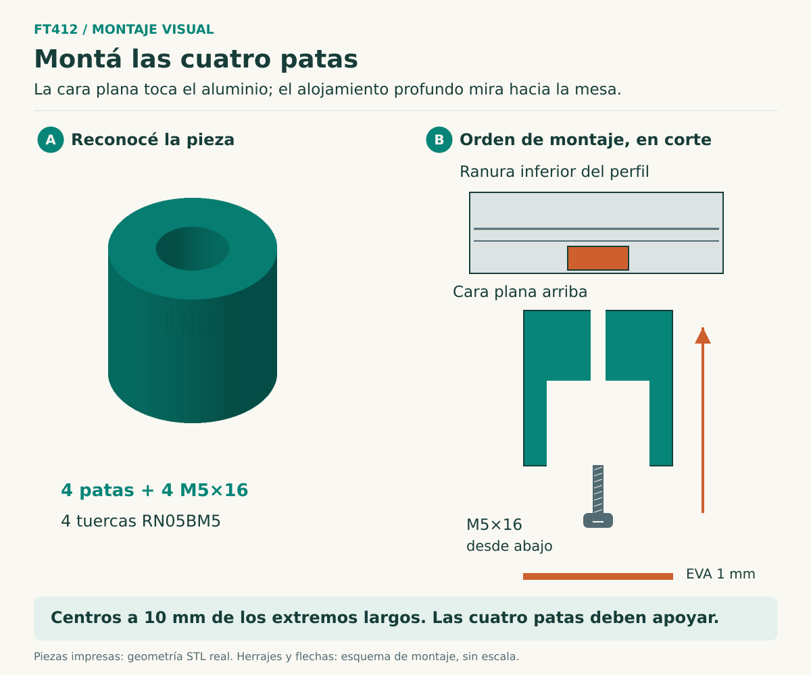

1. Con el marco invertido y protegido, introducí dos RN05BM5 en la ranura de la cara inferior de cada costado. Asentalas detrás de los labios, con la rosca hacia el tornillo.
2. Colocá cada pata con la cara plana contra el aluminio y el hueco profundo mirando hacia la mesa. Centro nominal: 10 mm desde el extremo del costado.
3. Pasá el M5×16 por el hueco profundo y enroscalo en la RN05BM5. Debe sujetar la pata antes de hacer fondo; no deformés el plástico.
4. Pegá la EVA en las cuatro superficies de apoyo. Volvé a poner el marco derecho y comprobá que las cuatro patas apoyen.

**Comprobá antes de seguir:** no hay balanceo y ninguna pata gira libre o tiene una grieta.

## Paso 06. Fijar los dos travesaños con escuadras

**Necesitás para este paso**

| Pieza o herraje | Cant. | Uso en este paso |
|---|---:|---|
| Travesaño delgado 10×20×190 precargado | 2 | Con 2 SQN05M4 cada uno |
| Escuadra GS20-05W restante | 4 | Dos por travesaño |
| M4×8 LHCS restantes | 8 | Dos por escuadra |
| SQN05M4 ya colocadas | 8 | 4 en costados + 4 en travesaños |

**Herramientas:** regla, escuadra y Allen de 3 mm.

**Antes de montar:** Usá las tuercas que dejamos dentro en el paso 02. Los travesaños van debajo del marco; no son el puente móvil de 185 mm.

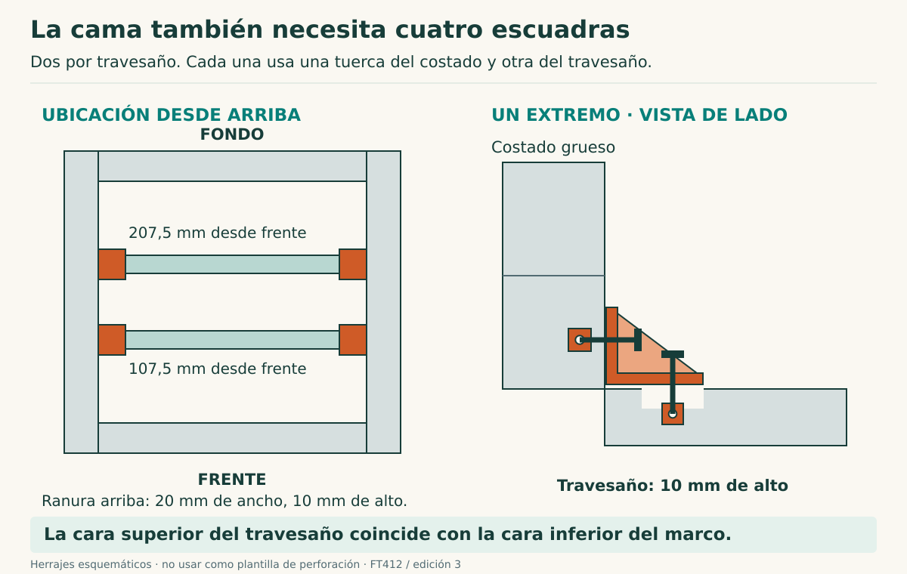

1. Marcá en ambos costados los centros a 107,5 y 207,5 mm desde el borde exterior del frente.
2. Presentá un travesaño en cada marca: sección con 20 mm en vertical y 10 mm en el sentido del largo de la máquina. La ranura precargada mira hacia arriba.
3. En cada extremo poné una escuadra: un ala contra la cara interior del costado y la otra sobre la cara superior del travesaño. Esa cara superior queda al nivel de la cara inferior del marco.
4. Un M4×8 une cada ala con su SQN05M4: cuatro tornillos por travesaño. Presentá ambos, verificá alturas y paralelismo, y apretá gradualmente.

**Comprobá antes de seguir:** dos travesaños fijos y paralelos, cuatro escuadras nuevas montadas. Las 16 SQN05M4 del kit quedan utilizadas.

## Paso 07. Atornillar la cama del teléfono

**Necesitás para este paso**

| Pieza o herraje | Cant. | Uso en este paso |
|---|---:|---|
| Cama impresa | 1 | Sobre los dos travesaños |
| FHCS M3×8 avellanados | 4 | Uno por oreja de la cama |
| RN05BM3 de entrada lateral | 4 | Dos en la ranura superior de cada travesaño |

**Herramientas:** Allen que ajuste por completo al M3 recibido; regla.

**Antes de montar:** Colocá las cuatro RN05BM3 antes de bajar la cama, mientras la ranura sigue visible. Las SQN05M4 de las escuadras permanecen en sus lugares.

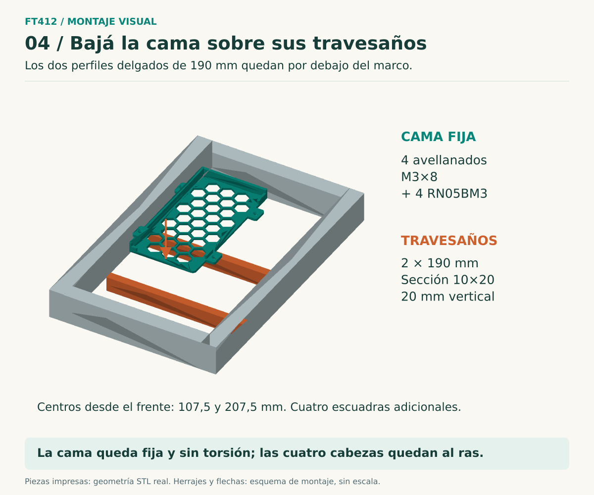

1. Introducí y asentá dos RN05BM3 en cada travesaño. Deslizalas hasta que coincidan con las cuatro orejas de la cama.
2. Apoyá la cama sin retorcerla. Poné los cuatro M3×8 avellanados y enganchá todas las roscas a mano antes de apretar uno.
3. Apretá alternando las orejas. Las cabezas deben quedar al ras de sus avellanados, sin hundirse rompiendo capas.

**Comprobá antes de seguir:** cama fija y plana, cuatro tornillos al ras. Todavía sin teléfono.

## Paso 08. Preparar los dos motores y sus soportes

**Necesitás para este paso**

| Pieza o herraje | Cant. | Uso en este paso |
|---|---:|---|
| Motor NEMA17 | 2 | A izquierdo y B derecho |
| Soporte impreso A / B | 1 de cada | A: patas 8 mm; B: patas 12 mm |
| BHCS M3×6 | 8 | 4 de cada motor a su soporte |
| BHCS M5×16 | 2 | Soporte A al perfil trasero |
| BHCS M5×20 | 2 | Soporte B al perfil trasero |
| RN05BM5 | 4 | 2 por soporte en la ranura del perfil |

**Herramientas:** llaves Allen para M3 y M5; regla.

**Antes de montar:** Los soportes impresos ya incorporan las alturas de 8 y 12 mm. No añadas los separadores metálicos del video.

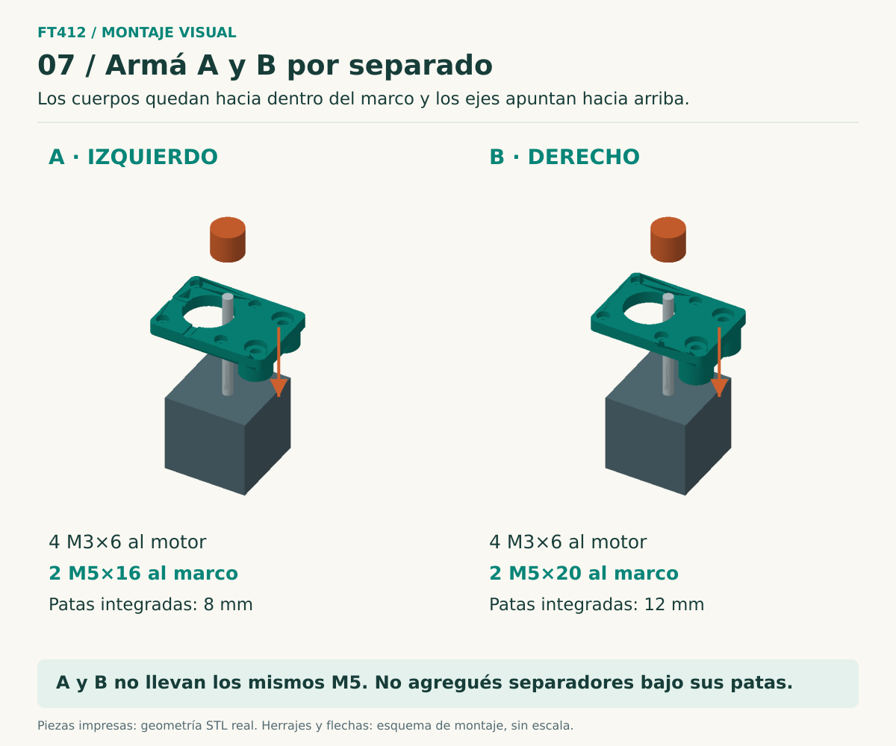

1. Poné A junto al motor izquierdo y B junto al derecho. Colocá cada motor plano contra su soporte y empezá sus cuatro M3×6 a mano.
2. Apretá los cuatro tornillos en cruz. La cara del motor debe quedar asentada sin que un tornillo haga fondo.
3. Introducí las cuatro RN05BM5 en la ranura superior del perfil del fondo, antes de cubrirla con los soportes.
4. Presentá A con dos M5×16 y B con dos M5×20, cuerpos hacia el interior y ejes arriba; conectores hacia los costados exteriores. Dejá el anclaje al marco ajustable para alinear las correas.

**Comprobá antes de seguir:** A está a la izquierda y B a la derecha; ambos motores quedan planos. Los tornillos al marco todavía permiten ajustar la posición.

**Detalle importante:** Referencia nominal de ejes: 47,5 mm a cada lado del centro y 42 mm desde el borde exterior trasero; verificá alineación con las poleas antes del apriete final.

## Paso 09. Colocar las poleas de los motores

**Necesitás para este paso**

| Pieza o herraje | Cant. | Uso en este paso |
|---|---:|---|
| Polea motriz GT2, 20 dientes, eje de 5 mm | 2 | Una en cada motor |
| Prisioneros de las poleas | Los incluidos | Fijan cada polea al eje |

**Herramientas:** Allen de los prisioneros y regla o calibre.

**Antes de montar:** Identificá la cara plana de cada eje. No confundás estas poleas con las dentadas libres, que llevan rodamientos.

1. Deslizá una polea en cada eje. A trabaja en el plano inferior; B en el superior.
2. Presentá las alturas nominales del proyecto: separación del cubo al plano de referencia A = 0 mm y B = 5 mm. No midás desde un rebaje o resalte del soporte.
3. Hacé coincidir un prisionero con la cara plana del eje. Asentalo y luego el otro. Girá para comprobar que no roza el soporte.
4. El apriete y fijador de roscas de los prisioneros se completan después de alinear las correas; no uses fijador en las piezas plásticas.

**Comprobá antes de seguir:** las dos poleas giran sin tocar plástico y quedan en dos alturas diferentes. La alineación final sigue pendiente del recorrido real.

## Paso 10. Preparar los cuatro bloques fijos de poleas

**Necesitás para este paso**

| Pieza o herraje | Cant. | Uso en este paso |
|---|---:|---|
| Bloque impreso trasero, largo | 2 | Dos ejes por bloque |
| Bloque impreso delantero, corto | 2 | Un eje por bloque |
| Tuerca cuadrada M4 pequeña | 6 | 4 en traseros + 2 en delanteros |
| Tuerca cuadrada M5 | 2 | Una en cada trasero, para su riostra |
| BHCS M5×10 | 4 | Uno por bloque al perfil |
| RN05BM5 | 4 | Anclaje de los cuatro bloques al aluminio |

**Herramientas:** Allen de M5, pinza fina y herramienta para quitar restos de soporte.

**Antes de montar:** Prepará los alojamientos y la fijación central ANTES de añadir las poleas. No uses SQN05M4 de 9 mm en los bolsillos M4 impresos.

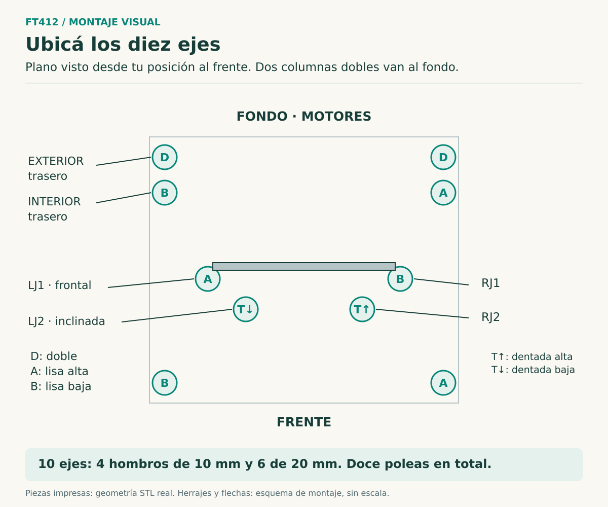

1. Insertá las tuercas M4 en los bolsillos: dos en cada trasero y una en cada delantero. Alineá las roscas con los agujeros de eje.
2. Insertá también una tuerca M5 en el bolsillo superior de cada trasero. Quedará accesible para la placa plana de refuerzo.
3. Poné ahora el M5×10 central de cada bloque, antes de que las poleas tapen el acceso. Prepará sus RN05BM5 en las ranuras de los perfiles.
4. Presentá los bloques en sus esquinas según el mapa: largos junto a los motores, cortos al frente. Dejá el anclaje ajustable mientras se presentan rieles y recorrido.

**Comprobá antes de seguir:** las 6 tuercas M4 y las 2 M5 están dentro de los bloques; los cuatro tornillos centrales están puestos y accesibles.

## Paso 11. Montar las seis columnas de poleas fijas

**Necesitás para este paso**

| Pieza o herraje | Cant. | Uso en este paso |
|---|---:|---|
| Bloques preparados del paso 10 | 4 | Ya tienen sus tuercas |
| Polea libre lisa | 8 | 3 por trasero + 1 por delantero |
| Eje de hombro Ø5×10, rosca M4 de 8 mm | 2 | Trasero izquierdo interior y delantero izquierdo |
| Eje de hombro Ø5×20, rosca M4 de 8 mm | 4 | Demás columnas fijas |
| Separador liso de 9 mm | 2 | Columnas derechas de una sola polea |
| Arandelas ID5/OD8 de 0,5 / 0,3 mm | 22 / 6 | Bases y ajuste superior nominal |

**Herramientas:** Allen de los ejes, calibre y pinza.

**Antes de montar:** Los ejes fijos conservan sus 8 mm de rosca. Prepará cada columna por separado siguiendo la tabla de columnas fijas de este paso.

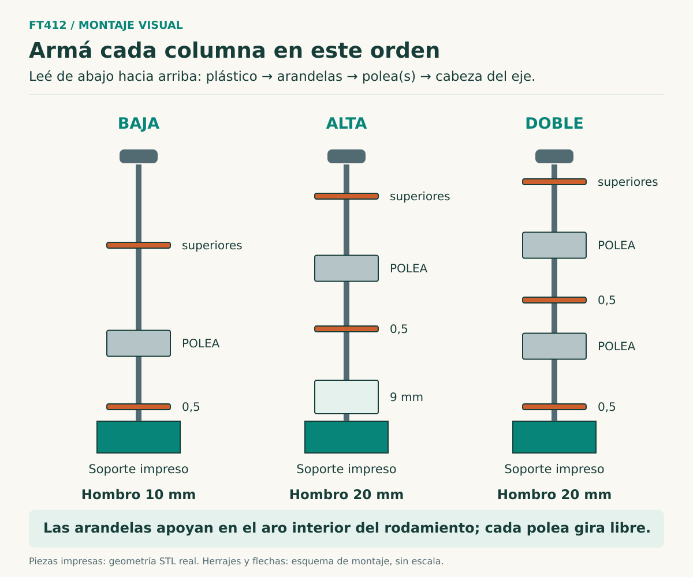

1. Insertá cada eje desde arriba a través de su conjunto; la rosca termina en la tuerca M4 ya colocada en el bloque. El hombro liso asienta en el soporte.
2. Usá el orden inferior y las arandelas superiores de la tabla. «Exterior trasero» es la columna más cercana al fondo; «interior», la más cercana al frente.
3. Apretá el eje y girá cada polea con el dedo. Las arandelas actúan sobre el aro interior del rodamiento; no deben frenar su aro exterior.
4. Medí el juego axial real. El objetivo inicial es 0,1–0,3 mm: ajustá arandelas superiores si las poleas reales lo requieren; conservá las inferiores que fijan la altura.

**Comprobá antes de seguir:** las 8 poleas fijas giran libres tras apretar. Ningún eje sobresale donde interfiera con otra pieza.

### Columnas fijas: orden desde el plástico

| Columna fija | Hombro | Desde el plástico hacia arriba | Arandelas encima |
|---|---:|---|---|
| Trasera izquierda exterior | 20 mm | 0,5 / lisa / 0,5 / lisa | 0,5 + 0,5 + 0,5 + 0,3 |
| Trasera izquierda interior | 10 mm | 0,5 / lisa | 0,5 + 0,3 |
| Trasera derecha exterior | 20 mm | 0,5 / lisa / 0,5 / lisa | 0,5 + 0,5 + 0,5 + 0,3 |
| Trasera derecha interior | 20 mm | separador 9 / 0,5 / lisa | 0,5 + 0,5 + 0,5 + 0,3 |
| Delantera izquierda | 10 mm | 0,5 / lisa | 0,5 + 0,3 |
| Delantera derecha | 20 mm | separador 9 / 0,5 / lisa | 0,5 + 0,5 + 0,5 + 0,3 |

Todas las cifras de arandelas están en mm. La cabeza del eje cierra la columna por arriba. Son espesores de partida, no una medición de las poleas recibidas.

## Paso 12. Añadir las dos riostras traseras

**Necesitás para este paso**

| Pieza o herraje | Cant. | Uso en este paso |
|---|---:|---|
| Placa plana de unión 40×18 | 2 | Una por bloque trasero |
| BHCS M5×10 | 2 | Extremo de la riostra que toca aluminio |
| Arandela DIN125 M5 de 1 mm | 2 | Solo bajo esos M5×10 |
| RN05BM5 | 2 | Dentro del perfil, para la riostra |
| BHCS M5×12 | 2 | Extremo que toca el bloque impreso |
| Tuercas cuadradas M5 ya cargadas | 2 | Reciben los M5×12 |

**Herramientas:** Allen M5 y calibre.

**Antes de montar:** Estas placas son planas. No son las escuadras triangulares GS20 del marco.

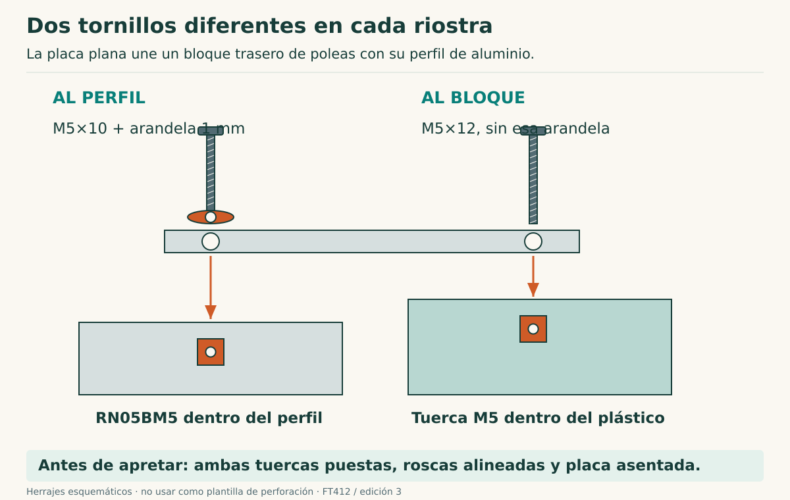

1. Introducí una RN05BM5 junto a cada bloque trasero. Presentá una placa plana uniendo el bloque y el perfil.
2. En el agujero sobre aluminio usá M5×10 CON arandela de 1 mm; en el agujero sobre plástico, M5×12 SIN esa arandela.
3. Enroscá el primero en la RN05BM5 y el segundo en la tuerca M5 del bloque. Confirmá agujeros, espesor y asiento reales antes de apretar.
4. Conservá ajustable la posición del conjunto hasta que rieles y poleas estén alineados.

**Comprobá antes de seguir:** hay dos fijaciones distintas por riostra; ninguna confunde la tuerca de perfil con la del bloque.

## Paso 13. Presentar los dos rieles largos

**Necesitás para este paso**

| Pieza o herraje | Cant. | Uso en este paso |
|---|---:|---|
| Riel MGN9 de 250 mm con su carro | 2 | Costados del marco |
| BHCS M3×8 | Hasta 26 | Uno por agujero real de los dos rieles |
| RN05BM3 | Hasta 26 | Una por tornillo, en la ranura superior |

**Herramientas:** Allen M3, regla, paño limpio y topes temporales de los carros.

**Antes de montar:** Contá los agujeros reales: máximo previsto 13 por riel. Los carros permanecen en sus rieles; no los saqués por el extremo.

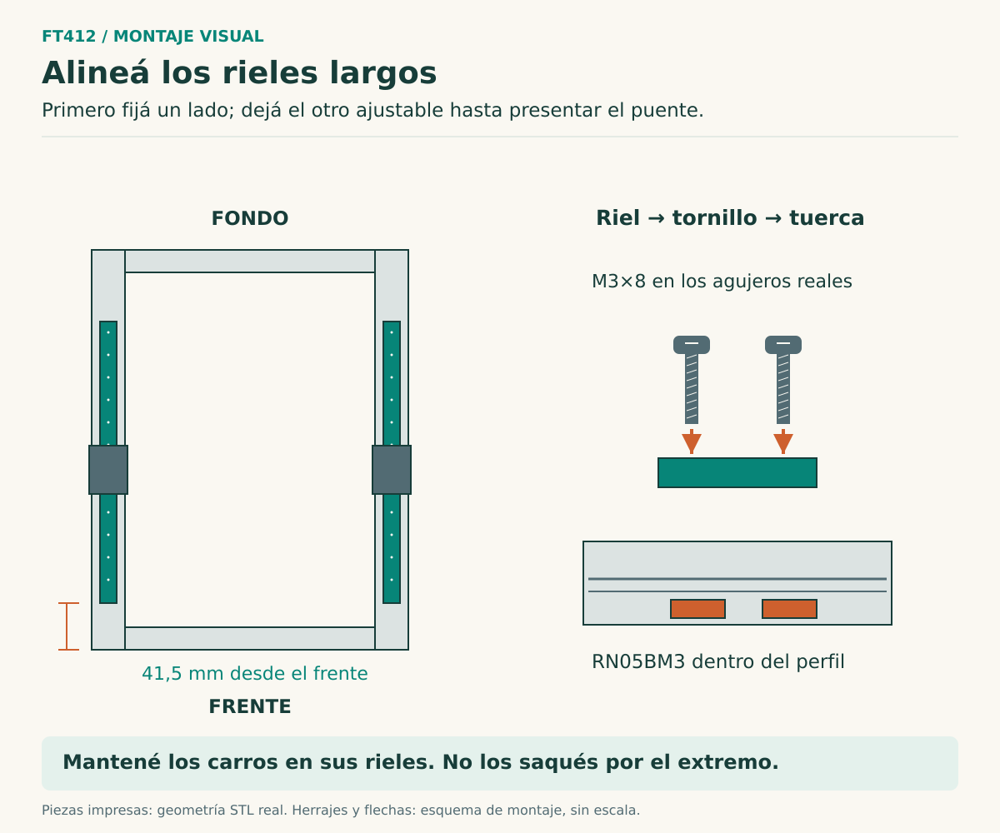

1. Introducí y distribuí las RN05BM3 en la ranura superior de cada costado. Limpiá las caras de apoyo.
2. Presentá los rieles con sus extremos alineados entre sí: posición nominal 41,5–291,5 mm desde el frente exterior. Cotejá los bloques fijos antes del apriete.
3. Pasá un M3×8 por cada agujero real y enroscalo en su tuerca. La cabeza queda por debajo del paso del carro; el tornillo no hace fondo.
4. Asentá un riel de referencia y dejá el otro ajustable. El ajuste final se hace con el puente colocado en el paso 18.

**Comprobá antes de seguir:** ambos carros siguen retenidos; los rieles están paralelos y todavía puede alinearse el segundo.

**Detalle importante:** La grasa prevista no tiene recepción confirmada en el registro de esta edición. No hagas recorridos repetidos con los carros secos; la lubricación se completa antes del uso.

## Paso 14. Preparar los cuatro ejes de las uniones móviles

**Necesitás para este paso**

| Pieza o herraje | Cant. | Uso en este paso |
|---|---:|---|
| Eje de hombro Ø5×10 con rosca M4 | 2 | LJ2 y RJ1 |
| Eje de hombro Ø5×20 con rosca M4 | 2 | LJ1 y RJ2 |
| Tuerca cuadrada M4 pequeña | 4 | Comprobar la rosca; luego va en cada bolsillo |

**Herramientas:** calibre, mordaza con protección, lima y protección ocular si hace falta ajustar la punta.

**Antes de montar:** Separá estos cuatro de los seis ejes fijos. La medida que cambia es la punta ROSCADA, no el hombro liso.

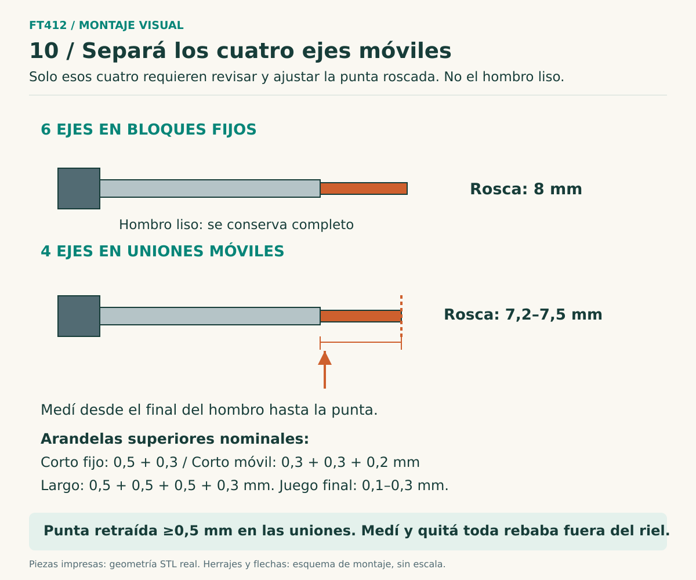

1. Medí desde el final del hombro liso hasta la punta de la rosca. El intervalo previsto para las uniones es 7,2–7,5 mm.
2. Si la punta mide 8 mm, ajustá solo su extremo fuera de la máquina, sin dañar el hombro ni las roscas útiles. Si ya cumple la medida, no la acortés otra vez.
3. Quitá rebabas, comprobá con la tuerca a mano y limpiá toda limadura antes de acercar el eje a los rieles.
4. Presentá cada eje en su unión: la punta debe quedar retraída al menos 0,5 mm de la cara que mira al carro. Si no podés medirlo, dejá ese eje pendiente de ajuste.

**Comprobá antes de seguir:** 4 puntas medidas, roscas limpias y hombros intactos. Los 6 ejes de bloques fijos no se modificaron.

## Paso 15. Poner las tuercas en las uniones antes de fijarlas

**Necesitás para este paso**

| Pieza o herraje | Cant. | Uso en este paso |
|---|---:|---|
| Unión XY impresa izquierda de máquina | 1 | Archivo xy_joint_right |
| Unión XY impresa derecha de máquina | 1 | Archivo xy_joint_left |
| Tuercas cuadradas M4 del paso 14 | 4 | Dos por unión |
| FHCS M3×10 | 8 | Cuatro por carro largo |

**Herramientas:** Allen M3 y pinza fina.

**Antes de montar:** Las tuercas de los ejes se ponen AHORA, con las entradas de los bolsillos accesibles. No cierres la unión contra el carro con el bolsillo vacío.

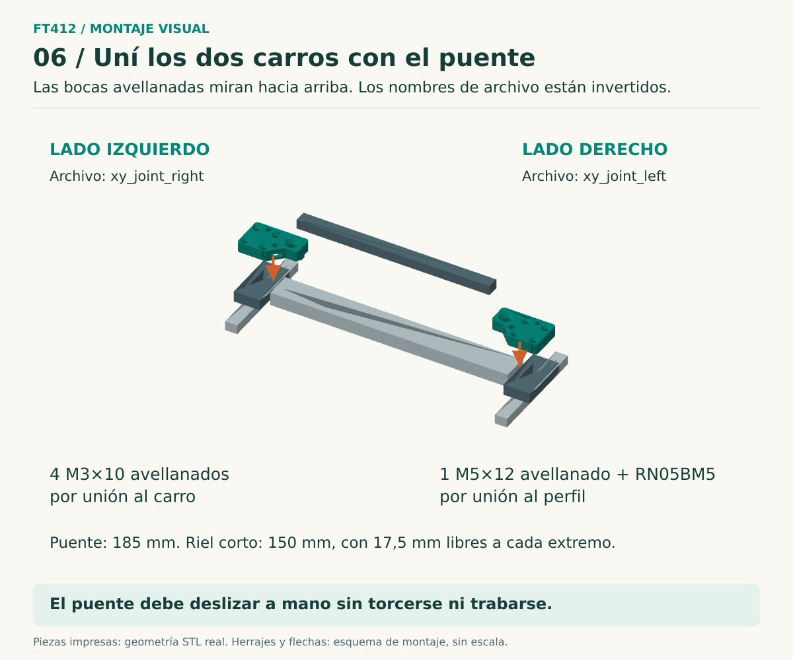

1. Insertá dos tuercas M4 en los dos bolsillos de cada unión; comprobá con un eje que las roscas quedan alineadas y luego retiralo.
2. Orientá las uniones con los avellanados arriba y la cara recta hacia los motores. La pieza cuyo archivo dice right va a la izquierda física; la que dice left, a la derecha.
3. Apoyá cada unión sobre su carro largo. Poné cuatro M3×10 avellanados, enganchá todos a mano y apretá en cruz.
4. No uses los M3 para empujar una tuerca mal asentada ni para forzar una pieza torcida.

**Comprobá antes de seguir:** 4 tuercas M4 cautivas instaladas antes del cierre y 8 avellanados asentados. Las uniones no se ladean.

## Paso 16. Unir los carros con el perfil de 185 mm

**Necesitás para este paso**

| Pieza o herraje | Cant. | Uso en este paso |
|---|---:|---|
| Perfil delgado 10×20×185 | 1 | Puente móvil |
| RN05BM5 | 2 | Una cerca de cada extremo de su ranura superior |
| FHCS M5×12 | 2 | Uno por unión XY |

**Herramientas:** Allen M5 y regla.

**Antes de montar:** Cargá las dos tuercas ANTES de poner el perfil bajo las uniones. Aunque son de entrada lateral, aquí el acceso quedará parcialmente cubierto.

1. Introducí las dos RN05BM5 en la ranura que mirará arriba y acercá una a cada extremo.
2. Presentá el perfil centrado entre las uniones. Sus lengüetas pequeñas entran en la ranura; los extremos del perfil quedan bajo las zonas de unión.
3. Pasá un M5×12 avellanado por cada unión y enroscalo en su RN05BM5. Asentá sin torcer el puente.
4. Mové el conjunto suavemente a mano unos centímetros, comprobando ambos lados; conservá el segundo riel ajustable.

**Comprobá antes de seguir:** las dos tuercas quedaron dentro antes de cubrir el perfil. El puente une los carros sin forzarlos.

## Paso 17. Montar el riel corto del puente

**Necesitás para este paso**

| Pieza o herraje | Cant. | Uso en este paso |
|---|---:|---|
| Riel MGN9 de 150 mm con carro | 1 | Sobre el perfil de 185 mm |
| BHCS M3×8 | Hasta 8 | Uno por agujero real |
| RN05BM3 | Hasta 8 | Dentro de la ranura superior del puente |

**Herramientas:** Allen M3 y regla.

**Antes de montar:** Contá los agujeros del riel recibido. Introducí sus tuercas antes de tapar la ranura con el riel; mantené el carro retenido.

1. Distribuí las RN05BM3 en la ranura, sin desplazar las dos M5 que ya sujetan los extremos.
2. Centrá el riel sobre el perfil de 185 mm: quedan nominalmente 17,5 mm de perfil libre en cada extremo.
3. Poné un M3×8 por agujero y asentá desde el centro hacia afuera. Comprobá que las cabezas no invadan el paso del carro.
4. Deslizá el carro corto despacio sin sacarlo del riel.

**Comprobá antes de seguir:** riel corto centrado, carro retenido y movimiento libre.

## Paso 18. Alinear el puente y cerrar las fijaciones

**Necesitás para este paso**

| Pieza o herraje | Cant. | Uso en este paso |
|---|---:|---|
| Conjunto de marco, tres rieles y puente | 1 | Reutiliza todas sus fijaciones; no añade piezas |

**Herramientas:** llaves Allen y regla.

**Antes de montar:** Los motores siguen sin alimentación. El segundo riel largo y los bloques todavía admiten ajuste.

1. Mové despacio el puente por el centro y cerca de ambos extremos. Si se endurece, aflojá y corregí el paralelismo; no tires con el motor.
2. Ajustá el segundo riel en pequeñas cantidades hasta que no fuerce lateralmente los carros.
3. Apretá progresivamente desde el centro hacia los extremos, comprobando de nuevo el movimiento después de cada tramo.
4. Confirmá las posiciones de los bloques fijos y sus riostras, el espacio real de los rieles y el giro libre de sus poleas; terminá sus fijaciones.

**Comprobá antes de seguir:** el puente y el carro corto se mueven a mano sin atascarse. La lubricación se completa antes del funcionamiento repetido.

## Paso 19. Montar las cuatro poleas móviles

**Necesitás para este paso**

| Pieza o herraje | Cant. | Uso en este paso |
|---|---:|---|
| Ejes preparados del paso 14 | 4 | Dos cortos y dos largos |
| Tuercas M4 ya dentro de las uniones | 4 | Reutilizadas; no añadir otras |
| Polea libre lisa / dentada | 2 / 2 | Una lisa y una dentada por unión |
| Separador de 9 mm | 2 | LJ1 y RJ2 |
| Arandelas ID5/OD8: 0,5 / 0,3 / 0,2 mm | 10 / 6 / 2 | Conjunto móvil nominal |

**Herramientas:** Allen de ejes, calibre y pinza.

**Antes de montar:** Consultá el mapa de la ilustración. Los nombres izquierda/derecha son los de la máquina vista desde el frente.

1. LJ1, bolsillo frontal izquierdo: eje largo, separador 9 mm, arandela 0,5 y polea lisa. LJ2, bolsillo inclinado izquierdo: eje corto, arandela 0,5 y polea dentada.
2. RJ1, bolsillo frontal derecho: eje corto, arandela 0,5 y polea lisa. RJ2, bolsillo inclinado derecho: eje largo, separador 9 mm, arandela 0,5 y polea dentada.
3. Encima de cada eje corto móvil añadí 0,3 + 0,3 + 0,2 mm; encima de cada largo, 0,5 + 0,5 + 0,5 + 0,3 mm. Enroscá en las tuercas ya cargadas.
4. Apretá y verificá giro y juego axial 0,1–0,3 mm con las piezas reales. Confirmá de nuevo que las cuatro puntas quedan retraídas y no tocan los carros.

**Comprobá antes de seguir:** cuatro poleas móviles libres y colocadas en sus alturas. En la máquina hay 10 poleas libres lisas y 2 dentadas.

## Paso 20. Preparar la abrazadera antes de cerrar el carro

**Necesitás para este paso**

| Pieza o herraje | Cant. | Uso en este paso |
|---|---:|---|
| Abrazadera de correa impresa | 1 | Sobre el carro del riel corto |
| Tuerca cuadrada M3 pequeña | 6 | 4 para la base de cuna + 2 para su pared |
| BHCS M3×8 | 4 | Abrazadera al carro; reservar para el paso 21 |
| Correa GT2 de 6 mm | Rollo disponible | Preparar dos recorridos sin cortar al ras |

**Herramientas:** pinza fina, Allen M3 y tijeras solo después de presentar recorridos.

**Antes de montar:** Las 6 tuercas se cargan antes de fijar la abrazadera al carro y antes de que las correas o la cuna dificulten el acceso.

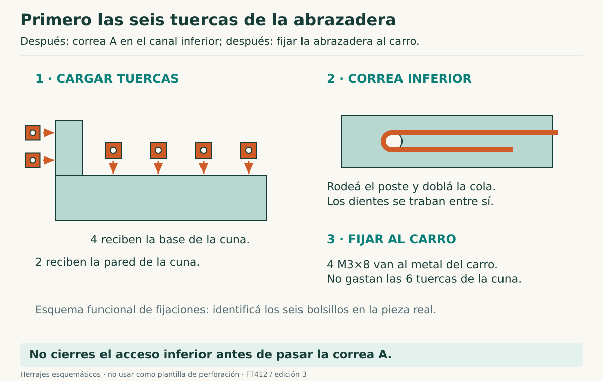

1. Limpiá los seis bolsillos de la abrazadera. Introducí cuatro tuercas M3 en los que recibirán la base de la cuna y dos en los de su pared.
2. Comprobá cada rosca con el tornillo correspondiente a mano y retiralo. No obligues la tuerca a atravesar plástico cerrado.
3. Presentá el recorrido de ambas correas con margen de ajuste. No tomes una longitud cortada del marco original como medida de este marco.
4. Dejá la abrazadera todavía separada: la correa A entra en su canal inferior ANTES de atornillarla al carro.

**Comprobá antes de seguir:** seis tuercas M3 presentes; el canal inferior está libre y accesible. Aún no cerraste el acceso de la correa A.

## Paso 21. Pasar la correa A y fijar la abrazadera

**Necesitás para este paso**

| Pieza o herraje | Cant. | Uso en este paso |
|---|---:|---|
| Correa GT2 de 6 mm | 1 | Recorrido A inferior; longitud presentada |
| Abrazadera con 6 tuercas del paso 20 | 1 | Reutilizada |
| BHCS M3×8 reservados | 4 | Abrazadera al carro |

**Herramientas:** Allen M3 y pinza fina.

**Antes de montar:** Los cuatro M3×8 se enroscan en el carro metálico, no en las seis tuercas reservadas para la cuna. El soporte del motor A sigue ajustable.

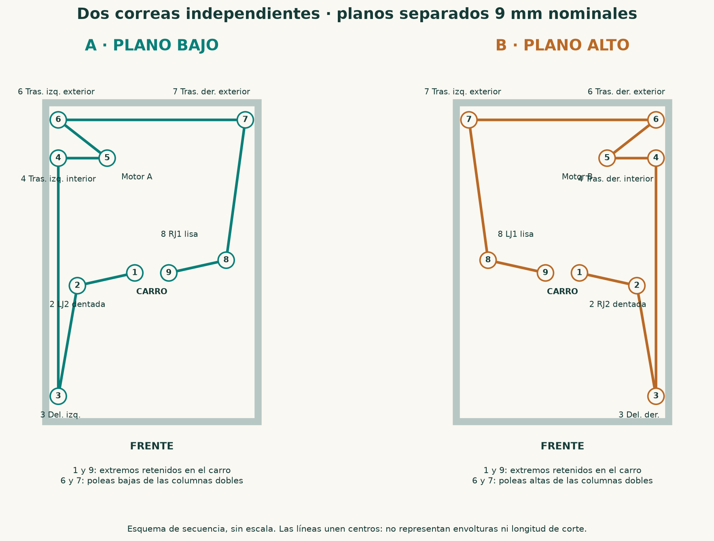

1. Pasá el primer extremo por el canal inferior de la abrazadera, rodeá el poste y doblá la cola contra la propia correa, dientes contra dientes. Dejá cola de ajuste.
2. Seguí el recorrido A del dibujo: carro → LJ2 dentada → delantero izquierdo → trasero izquierdo interior → motor A → polea baja trasera izquierda exterior → polea baja trasera derecha exterior → RJ1 lisa → carro.
3. Retené el otro extremo en el canal inferior mediante el mismo retorno. Dientes en poleas dentadas, dorso en lisas; no retuerzas la correa.
4. Ahora apoyá la abrazadera en el carro y fijala con los cuatro M3×8. Comprobá que el canal inferior no quedó pellizcado; quitá solo la holgura inicial deslizando el motor A.

**Comprobá antes de seguir:** A queda en un único plano inferior, ambos extremos retenidos y ninguna tuerca de la futura cuna bloqueada o perdida.

## Paso 22. Pasar la correa B y ajustar ambas

**Necesitás para este paso**

| Pieza o herraje | Cant. | Uso en este paso |
|---|---:|---|
| Correa GT2 de 6 mm | 1 | Recorrido B superior; longitud presentada |
| Motor B y abrazadera ya montados | 1 | Reutilizan sus fijaciones |

**Herramientas:** Allen de anclajes de motor y prisioneros.

**Antes de montar:** No cruces B al plano de A. Todavía no recortes las colas al ras.

1. Retené el primer extremo en el canal superior de la abrazadera mediante el retorno alrededor del poste.
2. Seguí B: carro → RJ2 dentada → delantero derecho → trasero derecho interior elevado → motor B → polea alta trasera derecha exterior → polea alta trasera izquierda exterior → LJ1 lisa → carro.
3. Retené el segundo extremo. Ajustá A y B progresivamente deslizando sus motores, con tensión comparable y sin doblar los soportes. Terminá los anclajes M5 de los motores cuando estén alineados.
4. Recorré a mano el área útil y mirá desde el costado: las correas conservan sus planos, no suben a las pestañas ni rozan tornillos. Asegurá los prisioneros ya alineados.

**Comprobá antes de seguir:** ningún extremo desliza, no hay tramos torcidos y el movimiento sigue libre.

**Detalle importante:** 75 Hz a 220 mm es una referencia del manual original, no una tensión validada para este marco y sus soportes FDM.

## Paso 23. Atornillar la cuna al carro

**Necesitás para este paso**

| Pieza o herraje | Cant. | Uso en este paso |
|---|---:|---|
| Cuna impresa del Adafruit 412 | 1 | Base y pared sobre la abrazadera |
| BHCS M3×8 | 4 | Base de la cuna |
| FHCS M3×10 | 2 | Pared de la cuna |
| Tuercas M3 cargadas en el paso 20 | 6 | Reutilizadas; ya deben estar dentro |

**Herramientas:** Allen M3.

**Antes de montar:** Verificá las seis tuercas antes de apoyar la cuna. No son los cuatro agujeros roscados del carro metálico.

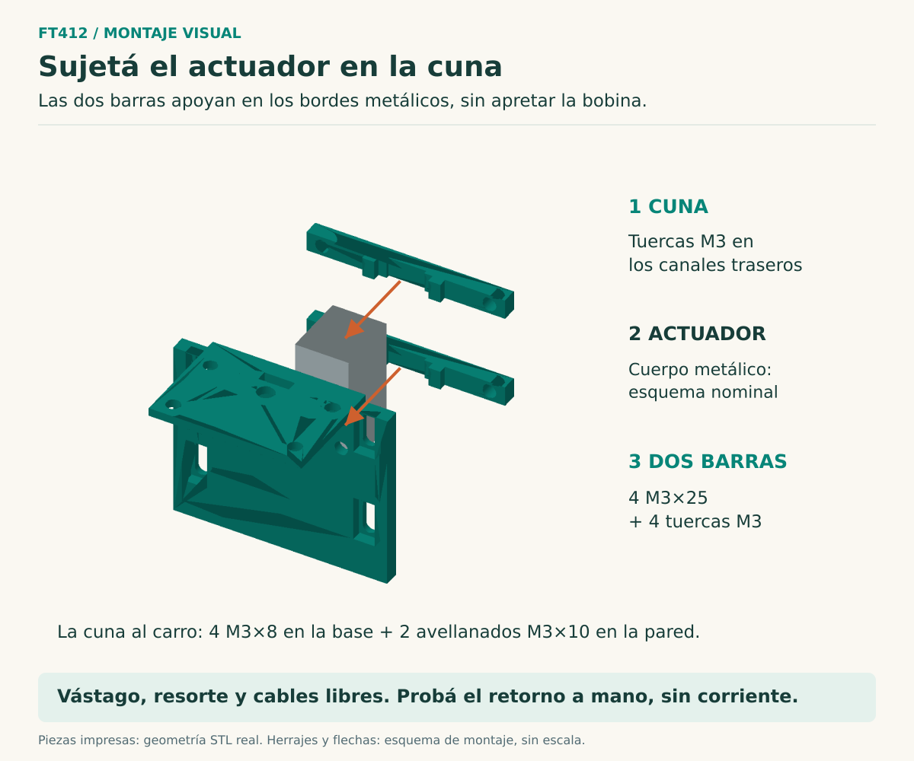

1. Presentá la base de la cuna sobre la abrazadera y alineá los cuatro agujeros inferiores y los dos de la pared.
2. Enroscá los cuatro M3×8 en las tuercas de la base y los dos M3×10 avellanados en las de la pared. Empezá todos antes de apretar.
3. Asentá progresivamente, sin cerrar los canales ni desplazar las correas. Mové el carro a mano para comprobar que nada nuevo roza.

**Comprobá antes de seguir:** cuna firme con 6 fijaciones; ambas correas conservan su recorrido.

## Paso 24. Sujetar el actuador con las dos barras

**Necesitás para este paso**

| Pieza o herraje | Cant. | Uso en este paso |
|---|---:|---|
| Adafruit 412 | 1 | Cuerpo metálico dentro de la cuna |
| Barra impresa | 2 | Apoyo sobre bordes del cuerpo metálico |
| BHCS M3×25 | 4 | Dos por barra |
| Tuerca cuadrada M3 | 4 | Canales posteriores de la cuna |

**Herramientas:** Allen M3 y pinza fina.

**Antes de montar:** Cargá las cuatro tuercas en los canales posteriores ANTES de introducir el actuador y cerrar las barras.

1. Insertá las cuatro tuercas y comprobá que coinciden con las ranuras de ajuste de la cuna.
2. Presentá el actuador con vástago hacia la futura punta. Conservá libres cables, resorte, bobina y movimiento del vástago.
3. Apoyá las dos barras en los bordes del marco metálico. Poné sus cuatro M3×25 hacia las tuercas posteriores; apretá alternando y sin aplastar la bobina.
4. Probá manualmente el movimiento y retorno completo. La regulación de altura de ±3 mm queda para la prueba sobre una superficie de ensayo.

**Comprobá antes de seguir:** el cuerpo está retenido; las barras no presionan bobina, cable o resorte y el vástago retorna libre.

## Paso 25. Cerrar el acoplador y retener la punta

**Necesitás para este paso**

| Pieza o herraje | Cant. | Uso en este paso |
|---|---:|---|
| Mitades impresas del acoplador | 1 delantera + 1 trasera | Rodean capuchón y collar |
| Punta de malla | 1 | Collar metálico retenido |
| BHCS M3×16 | 2 | Cierre de las mitades |
| BHCS M3×6 | 1 | Contacto lateral de referencia |
| Tuerca cuadrada M3 | 3 | 2 cierre + 1 contacto |
| Conductor flexible de referencia | Según recorrido real | Preparación de referencia; conexión eléctrica pendiente |

**Herramientas:** Allen M3 y multímetro para continuidad, sin alimentar.

**Antes de montar:** Insertá las tres tuercas en sus bolsillos ANTES de juntar las mitades. Si aún no tenés el conductor adecuado, dejá la tuerca y su M3×6 preparados; no declares la referencia terminada.

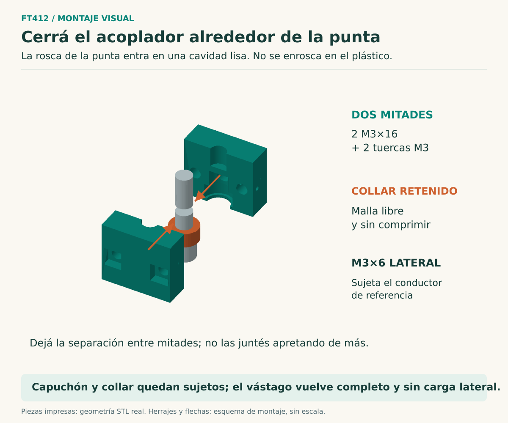

1. Apoyá capuchón del actuador y collar de la punta en sus alojamientos. El vástago no se dobla; la malla queda fuera y libre.
2. Juntá las mitades con los dos M3×16. La rosca de la punta entra en una cavidad lisa: no se atornilla al vástago ni al plástico.
3. Dejá la separación prevista entre mitades; no la elimines apretando de más. Comprobá retención del collar y retorno del actuador.
4. Cuando esté disponible el conductor, su M3×6 lateral lo sujeta contra el metal de la punta. Dejá holgura y comprobá continuidad hasta la malla; la conexión de referencia se revisa después.

**Comprobá antes de seguir:** punta retenida, malla sin aplastar y retorno completo. La primera prueba de contacto será sobre una superficie de ensayo, sin teléfono.

## Paso 26. Preparar y fijar el soporte electrónico

**Necesitás para este paso**

| Pieza o herraje | Cant. | Uso en este paso |
|---|---:|---|
| Soporte electrónico impreso | 1 | Ala y protector hacia fuera del marco |
| Tuerca cuadrada M3 | 4 | Futuras fijaciones de la DLC32 |
| FHCS M5×12 | 2 | Soporte al perfil trasero |
| RN05BM5 | 2 | Ranura exterior del perfil trasero |

**Herramientas:** Allen M5 y pinza fina.

**Antes de montar:** Colocá las cuatro tuercas M3 con el soporte aún en la mano. Revisá también las dos entradas inferiores: después serán más difíciles de alcanzar.

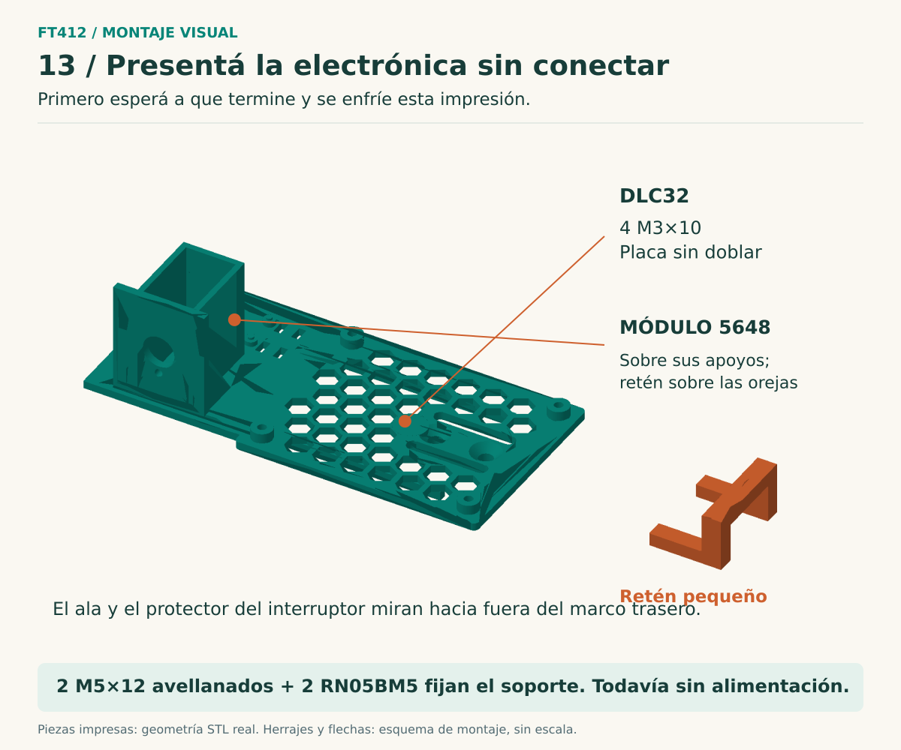

1. Limpiá los cuatro alojamientos M3 del soporte y cargá una tuerca por fijación de la placa. Probá cada rosca a mano.
2. Introducí las dos RN05BM5 en la ranura exterior trasera. Presentá el soporte con el ala del 5648 y protector del interruptor hacia afuera.
3. Pasá los dos M5×12 avellanados y asentalos en sus tuercas de perfil. No torzás el soporte.
4. Confirmá que motor, correas, USB y otros conectores tienen acceso antes de instalar las placas.

**Comprobá antes de seguir:** 4 tuercas M3 cautivas presentes y 2 anclajes M5 firmes; soporte sin deformación.

## Paso 27. Instalar la DLC32 y el módulo 5648

**Necesitás para este paso**

| Pieza o herraje | Cant. | Uso en este paso |
|---|---:|---|
| MKS DLC32 | 1 | Sobre sus cuatro apoyos |
| BHCS M3×10 | 4 | A las tuercas del paso 26 |
| Tuercas M3 ya cargadas | 4 | Reutilizadas |
| Adafruit 5648 | 1 | Plataforma lateral |
| Retén impreso pequeño | 1 | Sobre las orejas libres del 5648 |
| Bridas del kit | 4 | 2 retén + 2 alivio de tensión |

**Herramientas:** Allen M3 y cortador de bridas.

**Antes de montar:** Fuente y USB desconectados. No coloqués los drivers a ciegas: su orientación se verifica por pines y serigrafía antes del cableado.

1. Apoyá la DLC32 en los cuatro postes. Poné cuatro M3×10 en sus tuercas; ajustá apenas hasta retener la placa sin doblarla.
2. Asentá el 5648 en sus cuatro apoyos y dos tetones. Su cara inferior queda separada de la plataforma.
3. Colocá el retén pequeño sobre las dos orejas libres de componentes. Pasá dos bridas por sus postes o ranuras; nunca por encima de componentes.
4. Reservá las otras dos bridas para sujetar los cables y evitar que los tirones lleguen a los terminales.

**Comprobá antes de seguir:** placas firmes, planas, sin metal tocando pistas inferiores y sin conectores tapados.

## Paso 28. Montar y probar el espacio del interruptor

**Necesitás para este paso**

| Pieza o herraje | Cant. | Uso en este paso |
|---|---:|---|
| NKK S301T | 1 | Interruptor con terminales de tornillo |
| Tuercas y arandelas del propio interruptor | Juego incluido | Fijación de su rosca al soporte |

**Herramientas:** llave ajustable pequeña y buena iluminación.

**Antes de montar:** Esta es una prueba física SIN corriente. El protector se diseñó con otra variante de terminal; aquí verificamos el S301T real.

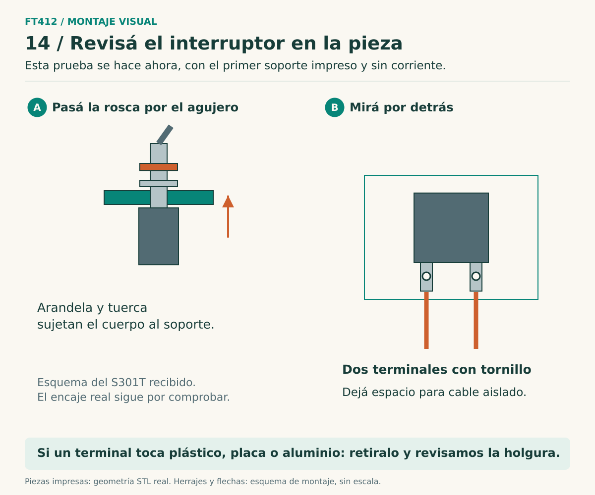

1. Pasá la rosca por el agujero redondo del panel. Presentá sus arandelas y tuercas, respetando el elemento antirrotación del conjunto recibido.
2. Sujetá el cuerpo para que no gire al asentar las tuercas. No apliques al plástico un par de apriete pensado para un panel metálico.
3. Mirá por detrás: ambos tornillos de terminal y el futuro cable aislado deben quedar separados del protector, placa y aluminio.
4. Accioná la palanca en ambas posiciones. Si algo toca o no permite alojar y aislar el cable, retiralo y registrá ese punto para ajustar la pieza; no dobles terminales.

**Comprobá antes de seguir:** cuerpo firme, palanca libre y espacio real para ambos terminales aislados. Si no cumple, este paso queda pendiente y no se cablea.

## Paso 29. Fijar el soporte del tubo y presentar el recorrido

**Necesitás para este paso**

| Pieza o herraje | Cant. | Uso en este paso |
|---|---:|---|
| Soporte largo del tubo impreso | 1 | Junto a electrónica |
| FHCS M5×12 | 2 | Fijación del soporte |
| RN05BM5 | 2 | Ranura del perfil trasero |
| Tubo PTFE previsto | 1 | Desde soporte hasta cabezal |
| Espiral y bridas disponibles | Según recorrido | Guiado exterior y alivio de tensión |

**Herramientas:** Allen M5 y cortador; cortar solo después de presentar.

**Antes de montar:** Cargá las dos tuercas de perfil antes de tapar su acceso. La curva se comprueba con el carro en la posición más alejada.

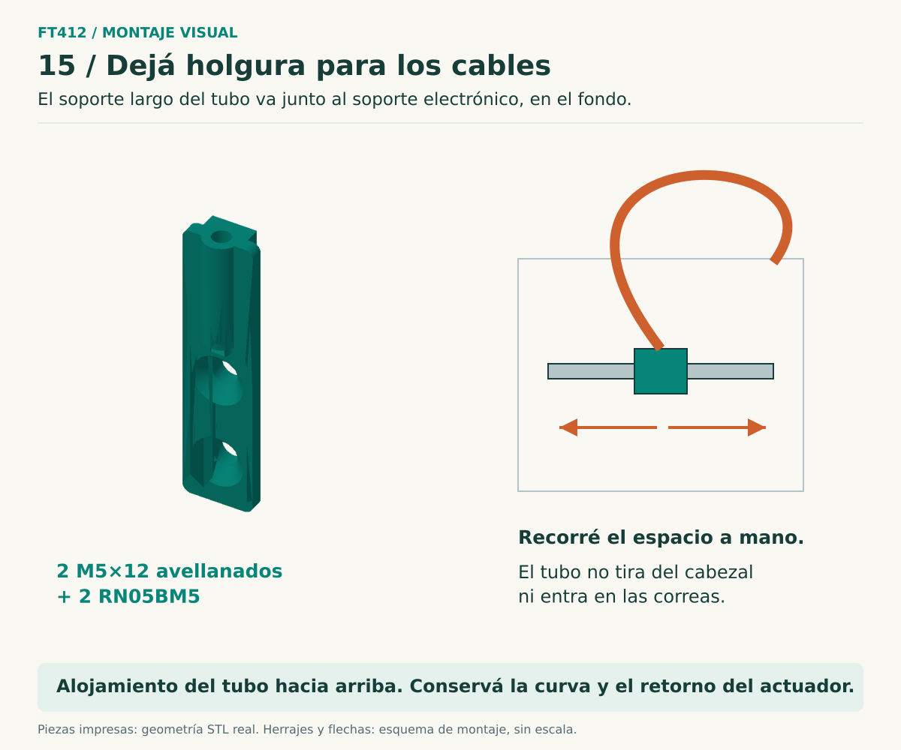

1. Asentá las RN05BM5 y fijá el soporte con dos M5×12 avellanados. El alojamiento del tubo mira hacia arriba.
2. Presentá el tubo hacia el cabezal, con una curva amplia que acompañe el movimiento. Comprobá esquinas y centro antes de decidir la longitud final.
3. El tubo guía el mazo por fuera con espiral; no metas a presión todo el cableado dentro del tubo.
4. Usá alivio de tensión en el extremo fijo y dejá holgura junto al actuador. Los cables no deben tirar de la punta ni entrar en las correas.

**Comprobá antes de seguir:** el tubo acompaña todo el recorrido sin tirones, enganches ni curvas cerradas.

## Paso 30. Revisión mecánica antes de cablear

**Necesitás para este paso**

| Pieza o herraje | Cant. | Uso en este paso |
|---|---:|---|
| Máquina montada en los pasos anteriores | 1 | Sin fuente, USB ni teléfono |
| Regla, calibre y hoja de avance | 1 | Registrar comprobaciones reales |

**Herramientas:** llaves manuales, regla y buena iluminación.

**Antes de montar:** Esta revisión no enciende motores ni actuador. No des por aprobada una comprobación solo porque la pieza se imprimió.

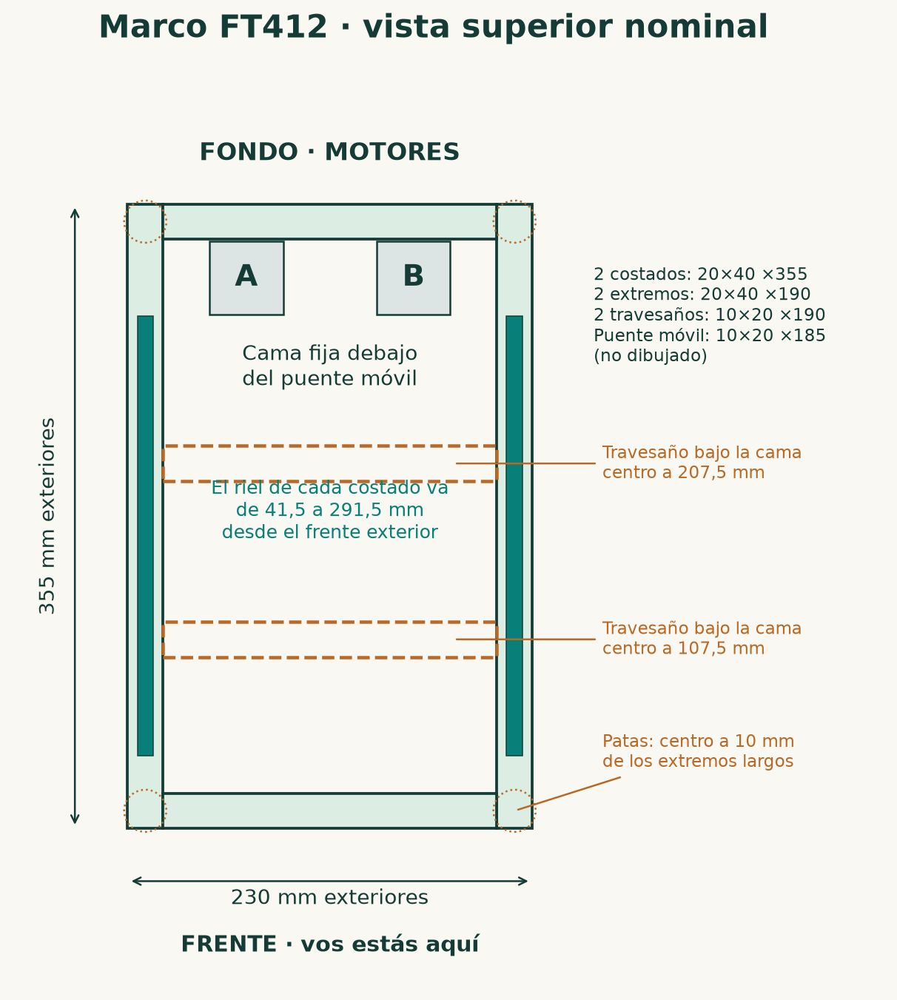

1. Confirmá escuadras, patas, cama y rieles: uniones asentadas, sin balanceo ni cabezas invadiendo el movimiento.
2. Revisá las diez columnas de poleas y sus puntas, las dos correas, las colas retenidas y los prisioneros. No debe haber piezas sueltas ni roce.
3. Recorré despacio el espacio a mano: sin atascos, deformación, cable tenso o tubo atrapado. Completá lubricación antes de uso repetido.
4. Probá el retorno del cabezal y la retención de la punta sobre una superficie de prueba. Dejamos cámara, cableado y calibración para la revisión específica de la unidad.

**Comprobá antes de seguir:** anotá lo comprobado y lo que necesita ajuste. El armado mecánico no implica que el cableado, calor o funcionamiento estén validados.

## Cableado y puesta en marcha: pendientes de esta unidad

La mecánica puede avanzarse ahora. **Esta edición no autoriza un encendido siguiendo un pinout supuesto:** falta cerrar el esquema de cableado específico, comprobar terminales y protección, configurar y probar el control. El cable flexible 18 AWG previsto para compra local aún no tiene compra confirmada en el registro de esta edición.

El Adafruit 412 es de **12 V / 0,3 A**. Su bobina se acciona mediante el módulo MOSFET externo Adafruit 5648, no desde un GPIO. El fabricante distingue alimentación V+, GND común de potencia/lógica, entrada In y salida Out conmutada a GND. Estas funciones **no identifican todavía el pin concreto de la DLC32** que se usará en esta máquina. Fuente: [pinout oficial del 5648](https://learn.adafruit.com/adafruit-mosfet-driver/pinouts).

Antes de energizar debe existir un dibujo de cableado de esta unidad y quedar comprobado:

- Polaridad y tensión reales de la fuente; conexiones de alimentación y protección apropiadas al cableado.
- Corte accesible que quite los 12 V de los actuadores y no solo una señal lógica.
- Orientación y ajuste de los drivers, pares de bobinas de motores y correspondencia de conectores. No enchufar o sacar motores o drivers con alimentación.
- Terminales S301T sujetos e individualmente aislados; continuidad y ausencia de cortos, sin conductores pelados junto al marco.
- Entrada del MOSFET en estado seguro al arrancar, al perder conexión y al detener el programa; temporizador de apagado probado.
- Conductor de referencia de la punta separado de potencia. El diseño base lo lleva al metal desnudo de un chasis de PC correctamente puesto a tierra; **no a un tomacorriente ni al GND de la placa**. Su implementación real se verificará antes de probar contacto táctil.

Este soporte abierto está destinado al circuito de baja tensión. No aloja conexiones de red eléctrica.

### Secuencia posterior de puesta en marcha

Estas pruebas quedan pendientes hasta completar la mecánica y la revisión eléctrica. Son criterios de avance, no resultados ya obtenidos.

1. **Sin alimentación:** recorrido manual completo, libre de roces, tornillos sueltos, cables tensos y puntas que sobresalgan. Lubricación compatible con los rieles reales antes de uso repetido.
2. **Sin teléfono y sin accionar la punta:** comprobar el corte y estados seguros. Probar desplazamientos cortos y lentos; verificar sentidos, distancia real y límites. No ejecutar un homing de origen desconocido.
3. **Recorrido controlado:** calibrar pasos por milímetro, origen y límites. El CAD permite como punto de partida geométrico 92 mm en X y 206 mm en el recorrido longitudinal, pero estas cifras no son coordenadas listas para copiar al firmware.
4. **Actuador sobre una superficie de prueba:** confirmar retorno, tiempo de encendido limitado y fallo seguro. El límite provisional del proyecto es como máximo 1 s encendido y descanso de al menos diez veces ese tiempo; hay que implementarlo y comprobarlo. No se da por existente en el firmware.
5. **Calor y estabilidad:** medir soportes de motores y cuna durante pruebas cortas. Detener e investigar a 45 °C en la superficie del soporte, deformación, deslizamiento o retorno incompleto. Es un umbral conservador de desarrollo, no una temperatura de servicio certificada del PLA ni de las tandas anteriores.
6. **Teléfono al final:** ajustar altura sin presión sostenida, verificar contacto suave, calibrar la cámara y hacer toques breves. No montar un tope rígido contra el vidrio. No habilitar acciones autónomas hasta probar pérdida de comunicación y apagado del actuador.

**Criterio para avanzar:** cada etapa funciona por sí misma antes de sumar la siguiente. La primera sesión puede terminar con un marco firme y escuadrado; no necesita terminar con la máquina encendida.

## Identificar piezas impresas y tornillos

Las siguientes láminas muestran la geometría real de los archivos. Cada pieza está ampliada para reconocerla; **no están todas a la misma escala**. Las medidas son las del archivo, no mediciones de las piezas recibidas de la impresora.

| Grupo | Piezas de instalación |
|---|---|
| Apoyo | 1 cama del teléfono y 4 patas |
| Motores | 1 soporte A y 1 soporte B |
| Transmisión | 2 bloques delanteros, 2 traseros, 2 uniones del puente y 1 abrazadera de correa |
| Cabezal | 1 cuna, 2 barras y 2 mitades del acoplador de la punta |
| Cables y electrónica | 1 soporte largo de tubo, 1 retén pequeño y 1 soporte electrónico |
| Total | 22 piezas; los tres cupones de prueba no se instalan |

Retirá brim y soportes de las superficies de contacto, alojamientos de tuercas y agujeros. Revisá que no haya grietas ni capas separadas. Una tuerca debe asentarse en su alojamiento sin abrir el plástico. No uses un tornillo largo para empujarla a la fuerza y no escales ni vuelvas a imprimir todas las piezas por un ajuste local.

**Comprobación:** las piezas se reconocen por forma y están limpias. El soporte electrónico también tiene finalización confirmada; su encaje se comprobará al llegar a esa etapa.

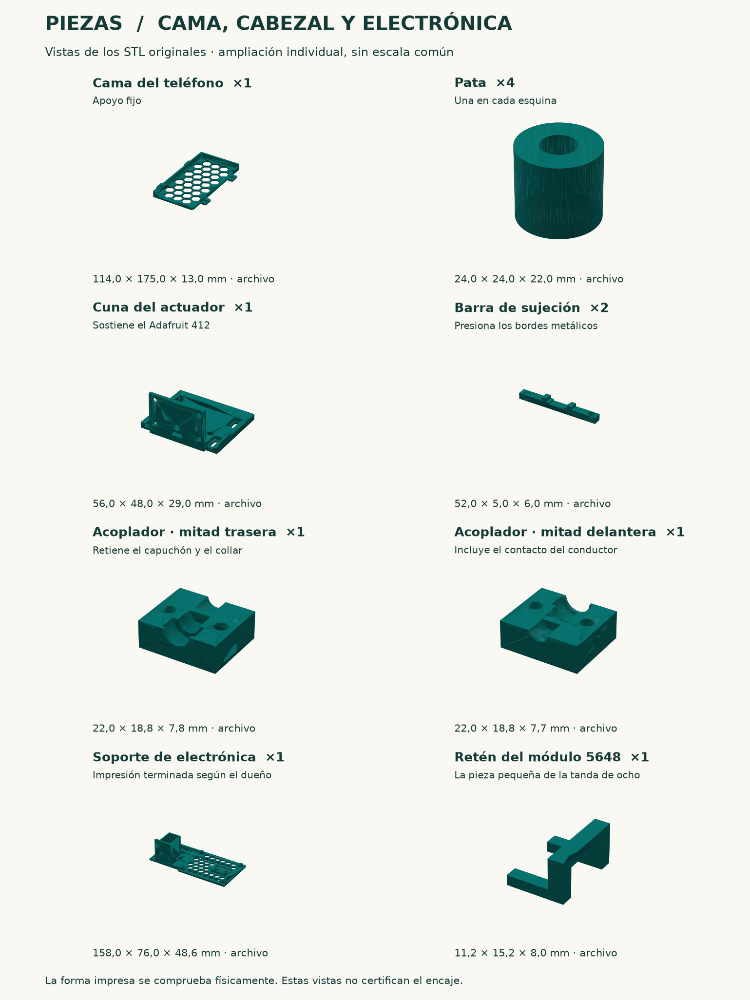

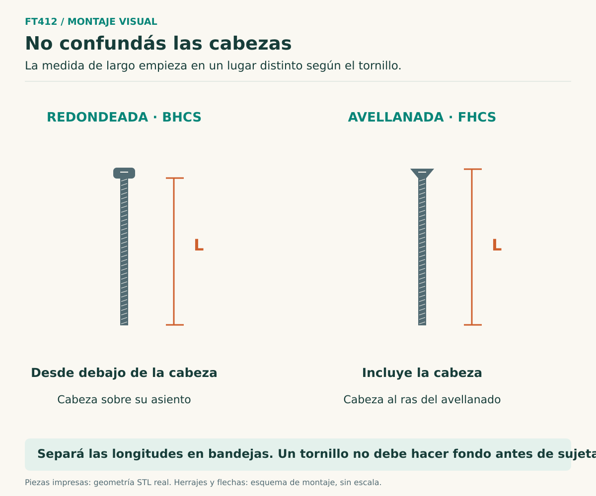

BHCS es cabeza redondeada con hexágono interior; FHCS es cabeza avellanada. La longitud del BHCS se mide bajo la cabeza; la del FHCS incluye la cabeza. Los tornillos con hombro se identifican por el tramo liso, no por su longitud total.

### Tornillos: cantidades por uso

| Tornillo | Cantidad máxima instalada | Uso |
|---|---:|---|
| BHCS M3×6 | 9 | 8 motores + 1 conductor de punta |
| BHCS M3×8 | 42 | Hasta 34 rieles + 4 abrazadera + 4 cuna |
| BHCS M3×10 | 4 | DLC32 |
| BHCS M3×16 | 2 | Acoplador de punta |
| BHCS M3×25 | 4 | Barras del actuador |
| FHCS M3×8 | 4 | Cama del teléfono |
| FHCS M3×10 | 10 | 8 uniones a carros + 2 pared de cuna |
| BHCS M5×10 | 6 | 4 bloques de poleas + 2 riostras al perfil |
| BHCS M5×12 | 2 | Riostras al bloque |
| BHCS M5×16 | 6 | 4 patas + 2 motor A |
| BHCS M5×20 | 2 | Motor B |
| FHCS M5×12 | 6 | 2 puente + 2 electrónica + 2 tubo |
| M4×8 del kit GS20 | 16 | Ocho escuadras |
| Hombro Ø5×10, rosca M4 | 4 | Poleas, según pasos 11 y 19 |
| Hombro Ø5×20, rosca M4 | 6 | Poleas, según pasos 11 y 19 |

Tuercas de perfil: **38 RN05BM3 como máximo**, **20 RN05BM5** y **16 SQN05M4 del kit de escuadras**. Tuercas cuadradas de alojamientos impresos: **17 M3, 10 M4 y 2 M5**. Arandelas de precisión nominales: **32 de 0,5 mm, 12 de 0,3 mm y 2 de 0,2 mm**, ID5/OD8, incluyendo las doce inferiores. Dos arandelas DIN125 M5 de 1 mm van únicamente en las riostras al perfil.

Estas cantidades describen el montaje, no una nueva orden de compra ni un conteo físico de todo el material. Si hay menos agujeros en los rieles, sobrarán M3×8 y tuercas M3. No inventés agujeros para agotar la cantidad máxima.

## Mapa de tuercas: revisar antes de cerrar

| Tipo | Total de instalación | Distribución y momento de entrada |
|---|---:|---|
| SQN05M4, 9×9×3 mm | 16 | Paso 02: 4 por costado largo, 2 por extremo grueso, 2 por travesaño de cama. Todas por el extremo. |
| RN05BM3, entrada lateral | Hasta 38 | 4 cama; hasta 26 rieles largos y 8 riel corto. Entrar antes de cubrir cada ranura con su pieza. |
| RN05BM5, entrada lateral | 20 | 4 patas + 4 motores + 4 bloques + 2 riostras + 2 puente + 2 electrónica + 2 tubo. |
| Cuadrada pequeña M3, para plástico | 17 | 6 abrazadera antes de cerrarla; 4 cuna antes del actuador; 3 acoplador antes de juntar mitades; 4 electrónica antes de poner la placa. |
| Cuadrada pequeña M4, para plástico | 10 | 6 bloques antes de las poleas; 4 uniones móviles antes de fijarlas a sus carros. |
| Cuadrada M5, para plástico | 2 | Una en cada bloque trasero antes de añadir las poleas. |

Las cantidades de tuercas ya precargadas aparecen de nuevo en el paso donde se usan, identificadas como «ya colocadas». No son tuercas adicionales.

## Hoja de avance

Fecha: ____________________

- [ ] Perfiles identificados y longitudes medidas.
- [ ] Las 16 SQN05M4 cargadas por el extremo antes de cerrar el marco.
- [ ] Marco plano, diagonales iguales antes y después de apretar.
- [ ] Cuatro patas apoyan y no hay balanceo.
- [ ] Cama fija y cabezas avellanadas al ras.
- [ ] Rieles y puente se desplazan a mano sin atascarse.
- [ ] A y B identificados; soportes y poleas firmes.
- [ ] Diez ejes correctos, cuatro puntas ajustadas y juego axial revisado.
- [ ] Dos correas en planos separados, retenidas y sin roces.
- [ ] Cabezal vuelve completo; acoplador y punta ajustados.
- [ ] Soporte electrónico terminado y terminales S301T con holgura real.
- [ ] Cableado específico revisado; corte, polaridad y aislamiento comprobados.
- [ ] Movimiento lento sin teléfono y límites calibrados.
- [ ] Actuador con timeout probado, retorno seguro y temperatura controlada.
- [ ] Contacto suave y cámara calibrados antes de control autónomo.

Medidas / piezas que requieren ajuste: ______________________________________

_______________________________________________________________________

## Video de apoyo para este montaje

El [tutorial de PhysiClaw](https://www.youtube.com/watch?v=Acmta1kzEko) dura 3 h 31 min y tiene capítulos. El [manual oficial también está en inglés](https://docs.physiclaw.ai/en/hardware/manual/), con ilustraciones y tornillería; consultamos la versión del 11 de noviembre de 2026. El autor da prioridad al manual sobre el video. Para FT412, conservamos las adaptaciones de esta guía.

**Cómo usarlo:** mirá el capítulo, pausá y seguí la tornillería y comprobación FT412. Mantenemos el orden de esta guía: que el video monte la cama más tarde no obliga a desarmarla.

| Parte del tutorial | Inicio | Aplicación al FT412 |
|---|---|---|
| Materiales y herramientas | [00:00](https://www.youtube.com/watch?v=Acmta1kzEko&t=0s) | Reconocimiento de formas; nuestras 22 piezas están en el anexo de piezas. |
| Marco | [16:53](https://www.youtube.com/watch?v=Acmta1kzEko&t=1013s) | Pasos 01–04: 355 mm y escuadras GS20. No copiar agujeros ni M6 del original. |
| Poleas libres | [27:23](https://www.youtube.com/watch?v=Acmta1kzEko&t=1643s) | Pasos 10–12 y 14–19: mantener nuestras arandelas y el ajuste de los cuatro ejes móviles. |
| Motores | [45:14](https://www.youtube.com/watch?v=Acmta1kzEko&t=2714s) | Pasos 08–09: A izquierdo, B derecho. Patas de 8/12 mm ya integradas en los soportes. |
| Rieles y puente | [56:26](https://www.youtube.com/watch?v=Acmta1kzEko&t=3386s) | Pasos 13–18: observar carros y alineación. Rieles Y de 250 mm y tornillería FT412. |
| Correas | [1:25:50](https://www.youtube.com/watch?v=Acmta1kzEko&t=5150s) | Pasos 20–22: observar el retorno en la abrazadera, A abajo y B arriba. Presentar el recorrido real antes de cortar. |
| Cabezal | [1:57:56](https://www.youtube.com/watch?v=Acmta1kzEko&t=7076s) | Pasos 23–25: Adafruit 412, barras y acoplador. No enroscar la punta al vástago. |
| Cama del teléfono | [2:28:30](https://www.youtube.com/watch?v=Acmta1kzEko&t=8910s) | Pasos 05–07: travesaños de 190 mm con escuadras; no los de 230 mm perforados. |
| Placa y cables | [2:40:17](https://www.youtube.com/watch?v=Acmta1kzEko&t=9617s) | Pasos 26–29 y revisión eléctrica: 5648, S301T y protección propios. No conectar el 412 directo a Spindle. |
| Cámara y pruebas | [3:15:03](https://www.youtube.com/watch?v=Acmta1kzEko&t=11703s) | Revisión eléctrica posterior: brazo externo; encendido y calibración tras verificar esta unidad. |

## Fuentes y límites de esta edición

Esta guía adapta la documentación del proyecto al montaje real. No cambia arquitectura, geometrías, cantidades del CAD ni el archivo histórico v0.1. El archivo original conserva su checksum. La finalización de impresiones y los ensayos físicos siguen registrados por separado.

- [Configuración y tornillería FT412](../hardware/ft412/README.md), [soportes de motor](../hardware/ft412/MOTOR-MOUNTS.md), [electrónica](../hardware/ft412/ELECTRONICS.md) y [pruebas de encaje](FIT-CHECKS.md).
- Registros CAD: [marco](../hardware/ft412/qa/framingtech-frame.json), [patas](../hardware/ft412/qa/feet.json), [ejes y arandelas](../hardware/ft412/qa/shoulder-axles.json), [integración](../hardware/ft412/qa/integration.json), [manifiesto de piezas](../hardware/ft412/qa/print-manifest.json). Son comprobaciones nominales; no certifican un ensamblaje físico.
- PhysiClaw hardware v0.51, commit `8f610d48642aef7d974d3ce09d28e14a4a99bbae`: [orientación de uniones](https://github.com/physiclaw/PhysiClaw/blob/8f610d48642aef7d974d3ce09d28e14a4a99bbae/hardware/assembly/procedures/linear_20_joint.py), [correa A](https://github.com/physiclaw/PhysiClaw/blob/8f610d48642aef7d974d3ce09d28e14a4a99bbae/hardware/assembly/procedures/belt_10_motor_a.py), [correa B](https://github.com/physiclaw/PhysiClaw/blob/8f610d48642aef7d974d3ce09d28e14a4a99bbae/hardware/assembly/procedures/belt_30_motor_b.py) y [criterios de montaje originales](https://github.com/physiclaw/PhysiClaw/blob/8f610d48642aef7d974d3ce09d28e14a4a99bbae/docs/hardware/assembly.mdx). Las dimensiones originales y las piezas MISUMI/ELECALL no se trasladan a este montaje.
- [Adafruit 412](https://www.adafruit.com/product/412), [plano del actuador](https://cdn-shop.adafruit.com/product-files/412/412_C514-B_diagram.PDF), [conexiones del driver 5648](https://learn.adafruit.com/adafruit-mosfet-driver/pinouts) y [NKK S301T, terminales con tornillo](https://www.nkkswitches.com/wp-content/themes/impress-blank/search/inc/part.php?part_no=S301T).

Mecánica derivada de PhysiClaw por Qiao Qian, licencia MIT. Se conserva el [aviso de licencia](../hardware/ft412/LICENSE) y la [atribución del proyecto](ATTRIBUTION.md). Las ilustraciones de esta edición combinan vistas de los STL con herrajes esquemáticos y flechas de colocación. No son fotografías de una máquina ya armada ni validación de encajes.

Esta edición sigue la estructura por operación del [manual de PhysiClaw](https://docs.physiclaw.ai/en/hardware/manual/): materiales, preparación, vista de montaje y comprobación. Las diferencias FramingTech, FDM y Adafruit 412 se mantienen explícitas.

El fabricante confirma que [SQN05M4 entra por el extremo](https://www.framingtech.com/shop/sqn05m4-square-nut-5mm-t-slot-m4-thread-485651); las tuercas [RN05BM3](https://www.framingtech.com/shop/rn05bm3-m3-roll-in-t-nut-with-ball-plunger-5-slot-484695) y [RN05BM5](https://www.framingtech.com/shop/rn05bm5-m5-roll-in-t-nut-with-ball-plunger-5-slot-484697) son de entrada lateral. La distribución de las 16 SQN05M4 es la deducida de los ocho anclajes GS20 del CAD de este proyecto.
