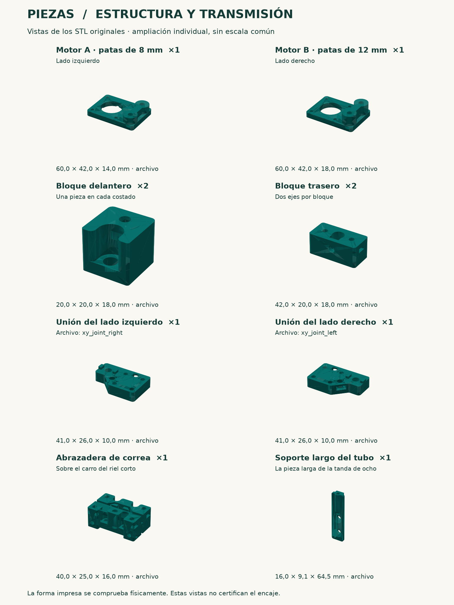
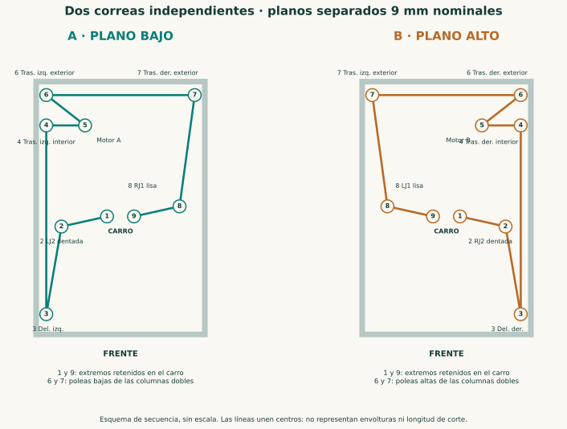

# Guía de ensamblaje · robot FT412

**Edición 1 · 15 de noviembre de 2026.** Para el montaje FramingTech 355/250 con actuador Adafruit 412. Esta guía corresponde a las piezas preparadas para este proyecto.

[Descargar el PDF para la mesa de trabajo](/downloads/guia-ensamblaje-ft412-es.pdf). Las ilustraciones de piezas se generan desde los STL publicados; los esquemas explican posiciones y no son plantillas de perforación.

## Antes de empezar

**Podemos empezar hoy por el marco, las patas y la presentación de los rieles.** No hace falta esperar a que termine el soporte de electrónica. Trabajaremos primero con la fuente y el USB desconectados y sin teléfono en la máquina.

Al cierre de esta edición hay **21 de las 22 piezas de instalación con impresión terminada registrada**. El soporte de electrónica está en impresión según el último reporte y observación; no se da por terminado por el tiempo transcurrido. La quinta tanda de ocho piezas está confirmada por el dueño: una pequeña, tres pares y una larga. No hay piezas adicionales por preparar ni motivo para repetir esas impresiones.

La preferencia actual es PLA. Las tandas anteriores conservan sus materiales reales: PLA Silk y PETG. Las pruebas M3, M4 y M5 fueron satisfactorias según el dueño en Silk; esto no certifica el montaje completo ni su comportamiento bajo calor o tensión.

**Para la primera sesión, separá:** los siete perfiles, ocho escuadras con sus tornillos, cuatro patas, cuatro M5×16 y cuatro tuercas de perfil M5. Tené a mano una superficie plana, regla o calibre, escuadra, llaves Allen y recipientes para separar tornillos. Usá herramienta manual para sentir cuándo asienta cada tornillo.

Cada etapa termina con una comprobación. Marcala solamente cuando la hayas hecho físicamente. Tener una pieza impresa o un paquete recibido no significa que esa comprobación ya pasó.

## 1. Cómo orientarnos

Miramos la máquina desde arriba, con **los dos motores al fondo** y el lado abierto para colocar el teléfono hacia nosotros. En toda esta guía, izquierda y derecha son las de esa vista.

Los dos perfiles largos forman los costados. Los dos perfiles gruesos cortos van **entre** ellos. El rectángulo exterior nominal mide **230 mm de ancho × 355 mm de largo** y tiene 40 mm de alto. Los perfiles largos presentan 20 mm de ancho en planta y 40 mm en vertical.

El puente móvil cruza de izquierda a derecha. Lleva el riel corto y se desplaza sobre los dos rieles largos. La cama del teléfono queda fija debajo. Las referencias de distancia longitudinal de este dibujo se miden desde el borde exterior del frente.

Los archivos CAD usan otros nombres de ejes: su Z recorre el largo y su −Y apunta físicamente hacia arriba. **No copies esas coordenadas al control de la máquina.** El origen y los sentidos de movimiento se calibran al final.

## 2. Reconocer lo que ya imprimimos

Las siguientes láminas muestran la geometría real de los archivos. Cada pieza está ampliada para reconocerla; **no están todas a la misma escala**. Las medidas son las del archivo, no mediciones de las piezas recibidas de la impresora.

| Grupo | Piezas de instalación |
|---|---|
| Apoyo | 1 cama del teléfono y 4 patas |
| Motores | 1 soporte A y 1 soporte B |
| Transmisión | 2 bloques delanteros, 2 traseros, 2 uniones del puente y 1 abrazadera de correa |
| Cabezal | 1 cuna, 2 barras y 2 mitades del acoplador de la punta |
| Cables y electrónica | 1 soporte largo de tubo, 1 retén pequeño y 1 soporte electrónico |
| Total | 22 piezas; los tres cupones de prueba no se instalan |

Retirá brim y soportes de las superficies de contacto, alojamientos de tuercas y agujeros. Revisá que no haya grietas ni capas separadas. Una tuerca debe asentarse en su alojamiento sin abrir el plástico. No uses un tornillo largo para empujarla a la fuerza y no escales ni vuelvas a imprimir todas las piezas por un ajuste local.

**Comprobación:** las piezas se reconocen por forma y están limpias. El soporte electrónico puede seguir pendiente de terminar; eso no frena el marco.

## 3. Armar y escuadrar el marco

| Separá | Cantidad |
|---|---:|
| Perfil grueso 20×40, largo nominal 355 mm | 2 |
| Perfil grueso 20×40, largo nominal 190 mm | 2 |
| Escuadra GS20-05W | 4 |
| Tornillos M4×8 y tuercas SQN05M4 del kit de escuadras | 8 de cada uno |

1. Medí los perfiles para distinguirlos. El conteo previo de siete perfiles no fue una medición de los cortes. Reservá aparte los tres perfiles delgados: dos de 190 mm y uno de 185 mm.
2. Presentá los dos costados de 355 mm paralelos. Poné los dos de 190 mm entre ellos, con los extremos del rectángulo al ras. Comprobá la orientación 20 mm horizontal y 40 mm vertical.
3. Colocá una escuadra en cada esquina interior, en la **mitad inferior de 20 mm** de los perfiles. Cada escuadra usa dos tornillos y sus dos tuercas del kit. Debe quedar libre la zona superior donde van los rieles y la transmisión.
4. Enganchá las roscas a mano y dejá el conjunto ajustable. Las tuercas deben apoyar detrás de los labios de la ranura, no atravesadas sobre su abertura.
5. Sobre la mesa plana, acercá todas las uniones. Medí ambas diagonales entre los mismos puntos exteriores y comparalas. Ajustá hasta que coincidan dentro de la resolución de la regla y las cuatro esquinas apoyen sin balanceo.
6. Apretá progresivamente alternando esquinas. Volvé a medir las diagonales después del apriete. Si el marco se tuerce, aflojá y repetí la alineación.

**Comprobación:** las caras de unión apoyan, el rectángulo está plano y las diagonales siguen iguales. No hay escuadras invadiendo la cara superior.

Esta variante usa escuadras para evitar mecanizar los perfiles: **no hay que taladrarlos ni roscar sus extremos**. Las tuercas cuadradas de los alojamientos impresos no sustituyen las tuercas FramingTech de ranura.

## 4. Patas, travesaños y cama del teléfono

**Patas:** cuatro piezas cilíndricas, cuatro BHCS M5×16, cuatro RN05BM5 y las almohadillas de EVA de 1 mm previstas.

1. Con el marco apoyado sin cargar las piezas impresas, colocá una pata bajo cada extremo de los costados largos. Sus centros quedan nominalmente a **10 mm de cada extremo** del perfil largo.
2. El tornillo entra por el alojamiento profundo de la base de la pata y se enrosca en la tuerca de la ranura inferior. La cara plana de la pata asienta contra el perfil. Confirmá que el tornillo aprieta la pieza antes de hacer fondo en la ranura.
3. Colocá la EVA en la superficie que tocará la mesa, una vez revisado el apriete. Comprobá apoyo de las cuatro patas sin balanceo.

**Cama:** dos perfiles delgados 10×20 de 190 mm, las cuatro escuadras restantes con ocho M4×8 y ocho SQN05M4, una cama impresa, cuatro FHCS M3×8 y cuatro RN05BM3.

4. Presentá los dos travesaños entre los costados, debajo del marco. Sus centros longitudinales quedan a **107,5 y 207,5 mm desde el frente exterior**. En este montaje, los 10 mm de la sección quedan en el sentido del largo de la máquina y los 20 mm en vertical.
5. La cara superior de los travesaños queda al nivel de la cara inferior del marco principal. Las escuadras unen esa cara de los travesaños con las caras interiores de los costados, dentro de su mitad inferior. Usá dos escuadras por travesaño. No copies los agujeros pasantes del marco original de PhysiClaw: aquí no existen.
6. Presentá la cama sobre ambos travesaños. Alineá sus cuatro orejas con las tuercas M3 de las ranuras y colocá los cuatro tornillos avellanados M3×8. Las cabezas deben quedar al ras; no hundirlas a fuerza.

**Comprobación:** cama fija, sin torsión, tornillos al ras y escuadras sin tocarla. Todavía no coloqués el teléfono.

## 5. Rieles y puente móvil

**Separá:** dos rieles MGN9 de 250 mm con sus carros, un riel de 150 mm con carro, el perfil delgado de 185 mm, las dos uniones impresas, ocho FHCS M3×10, dos FHCS M5×12 y dos RN05BM5. Para los rieles: BHCS M3×8 y RN05BM3 según los agujeros reales, hasta 34 pares en total.

1. Conservá cada carro sobre su propio riel. No lo deslicés fuera del extremo: puede perder las bolas. Mantené tapones o topes temporales durante la presentación.
2. Limpiá las caras de apoyo y presentá un riel largo sobre la ranura superior de cada costado. Ambos apuntan en el mismo sentido y sus extremos quedan alineados entre sí.
3. La posición nominal de cada riel es **de 41,5 a 291,5 mm desde el frente exterior**. No se centra en los 355 mm: reserva espacio para los bloques de poleas. Presentá también esos bloques antes del apriete final; el margen longitudinal nominal es pequeño, 0,5 mm por extremo dentro del hueco de 251 mm.
4. Colocá un M3×8 y una RN05BM3 en cada agujero disponible del riel. El máximo previsto es 13 por cada largo y 8 en el corto; el riel real puede tener menos. La cabeza debe quedar por debajo de la superficie de paso del carro y el tornillo no debe hacer fondo.
5. Alineá y fijá primero un riel largo. Dejá el otro apenas sujeto hasta presentar el puente. Apretá de forma gradual, comprobando el desplazamiento después de cada tramo. No corrijás un atasco tirando con los motores.
6. Colocá las uniones sobre los carros con las bocas avellanadas hacia arriba, cuatro FHCS M3×10 por carro. **El archivo `fdm_xy_joint_right_x1` va en el lado izquierdo de la máquina y `fdm_xy_joint_left_x1` en el derecho**, vistos como en el dibujo 1. Es la orientación verificada en el montaje de referencia, no un error de impresión.
7. Presentá el perfil de 185 mm entre las uniones, centrado. Su ranura queda hacia arriba y sus extremos se sitúan por debajo de las zonas de unión. Las lengüetas pequeñas de las piezas entran en la ranura. Un FHCS M5×12 por lado se enrosca en una RN05BM5 dentro de ese perfil.
8. Centrá el riel de 150 mm sobre el perfil de 185 mm: nominalmente **17,5 mm libres en cada extremo**. Usá los M3×8 y las RN05BM3 de sus agujeros reales.
9. Mové el puente despacio y a mano por ambos extremos y el centro. Ajustá el segundo riel hasta eliminar puntos duros, sin forzar los carros contra los finales. Después terminá el apriete y repetí.

**Comprobación:** el puente se mueve suave, no se ladea ni se traba, y el carro del riel corto recorre su tramo libre. Esto comprueba alineación inicial; la lubricación y aceptación de movimiento todavía deben completarse. La grasa prevista sigue pendiente de recepción en el registro de esta edición.

## 6. Montar los motores

| Lado mirando desde el frente | Soporte | Tornillos al motor | Tornillos al marco |
|---|---|---|---|
| Izquierdo: motor A | Patas integradas de 8 mm; altura total 14 mm | 4 BHCS M3×6 | 2 BHCS M5×16 + 2 RN05BM5 |
| Derecho: motor B | Patas integradas de 12 mm; altura total 18 mm | 4 BHCS M3×6 | 2 BHCS M5×20 + 2 RN05BM5 |

1. Identificá A y B por la altura de sus patas. Asentá cada motor contra su soporte con los cuatro M3×6. Revisá que la cara quede plana y que los tornillos no hagan fondo en el motor.
2. Presentá ambos conjuntos en el perfil corto del fondo, con los cuerpos de los motores hacia el interior del rectángulo y sus ejes hacia arriba. Los dos tornillos M5 de cada soporte quedan separados 25 mm sobre la ranura.
3. Como referencia nominal, los centros de los ejes están a 47,5 mm a cada lado del centro del marco y a 42 mm del borde exterior trasero. Alineá físicamente con los bloques de poleas antes del apriete final.
4. Colocá las poleas dentadas de motor. La separación nominal de su cubo respecto del plano de apoyo de referencia es **A: 0 mm; B: 5 mm**. Esto conserva dos planos de correa separados 9 mm. El soporte impreso tiene rebajes: no midás desde una superficie añadida que sobresalga ni bajés la polea hasta que roce el plástico.
5. Alineá el prisionero adecuado con el plano del eje. Confirmá que la polea gira sin rozar y que su banda dentada queda a la misma altura que las poleas de su recorrido. Asegurá los prisioneros una vez confirmada la alineación.

**Comprobación:** soportes planos, sin grietas ni deformación; poleas libres y firmes sobre sus ejes. No se añaden los separadores de motor del diseño metálico anterior: las patas impresas ya cumplen esa función.

## 7. Preparar los ejes y poleas libres

Los cuatro bloques fijos van dos al frente y dos junto a los motores. Se fijan al perfil con **cuatro BHCS M5×10 y cuatro RN05BM5**. Los largos traseros tienen dos ejes; los cortos delanteros, uno. Cada unión móvil lleva otros dos: **diez ejes en total**, con diez tuercas cuadradas M4.

### Dónde va cada conjunto

En la tabla, **exterior trasero** significa la columna más cercana al extremo del fondo, e **interior** la más cercana al frente. El orden del conjunto se lee **desde el plástico hacia la cabeza del tornillo**. Todas las arandelas de precisión son ID5/OD8; no confundirlas con las arandelas M5 anchas de las riostras.

| Posición | Hombro liso del eje | Conjunto desde el plástico, antes de las arandelas superiores |
|---|---:|---|
| Trasero izquierdo, exterior | 20 mm | 0,5 / polea lisa / 0,5 / polea lisa |
| Trasero izquierdo, interior | 10 mm | 0,5 / polea lisa |
| Trasero derecho, exterior | 20 mm | 0,5 / polea lisa / 0,5 / polea lisa |
| Trasero derecho, interior | 20 mm | separador 9 / 0,5 / polea lisa |
| Delantero izquierdo | 10 mm | 0,5 / polea lisa |
| Delantero derecho | 20 mm | separador 9 / 0,5 / polea lisa |
| Unión izquierda, bolsillo frontal: LJ1 | 20 mm | separador 9 / 0,5 / polea lisa |
| Unión izquierda, bolsillo inclinado: LJ2 | 10 mm | 0,5 / polea dentada |
| Unión derecha, bolsillo frontal: RJ1 | 10 mm | 0,5 / polea lisa |
| Unión derecha, bolsillo inclinado: RJ2 | 20 mm | separador 9 / 0,5 / polea dentada |

Se usan diez poleas lisas, dos dentadas libres y cuatro separadores lisos de 9 mm. Los dos grupos traseros dobles tienen una polea en cada altura.

### Cuatro puntas roscadas requieren ajuste

Los tornillos previstos tienen hombro Ø5 y rosca M4 de 8 mm. **Solo los cuatro que van en las uniones móviles** necesitan que la punta roscada quede entre **7,2 y 7,5 mm**, medidos desde el final del hombro liso. Los seis de los bloques fijos conservan sus 8 mm. No acortés el hombro liso ni todos los tornillos del paquete.

Primero identificá esos cuatro y medí la pieza real. Si aún tienen 8 mm, sujetá la zona adecuada con mordazas suaves y ajustá únicamente la punta roscada, fuera de la máquina; quitá rebabas, comprobá la rosca con una tuerca a mano y retirale toda limadura antes de acercarla a los rieles. La punta debe quedar retraída al menos 0,5 mm respecto de la cara posterior de la unión. Si no podés medirlo, dejá esa unión sin terminar: no lo resolvás apretando más.

### Ajustar el juego sin frenar la polea

El hombro asienta en el soporte. Las arandelas deben apoyar en los aros interiores de los rodamientos. Añadí encima del conjunto nominal: **0,5 + 0,3 mm** en los dos ejes cortos fijos; **0,3 + 0,3 + 0,2 mm** en los dos cortos móviles; **0,5 + 0,5 + 0,5 + 0,3 mm** en los seis largos. Estas son cantidades de partida, sujetas a la altura real de las poleas.

Buscamos **0,1–0,3 mm de juego axial real**, giro libre y ningún roce entre poleas o plástico. No eliminés el juego apretando las pistas exteriores. Conservá las arandelas inferiores de 0,5 mm: fijan las alturas de las correas.

Los dos bloques traseros llevan además una riostra metálica de la placa de unión 40×18 prevista: **M5×10 con arandela DIN125 de 1 mm al perfil, M5×12 sin arandela al bloque**, por riostra. Usan dos RN05BM5 y dos tuercas cuadradas M5 en total. Verificá espesor y agujeros reales antes del apriete.

**Comprobación:** cada polea gira libre después de apretar su eje, las dos alturas se mantienen y ninguna punta de las uniones sobresale hacia el carro.

## 8. Pasar las dos correas

El sistema es CoreXY: cada motor mueve una correa independiente, con ambos extremos sujetos en el carro central. La correa A trabaja en el plano bajo; la B en el alto. **No se cruzan cambiando de altura a mitad de recorrido.**

El dibujo es una guía de secuencia, no una plantilla de tangencias, envolturas ni longitud de corte. Los puntos marcados representan las poleas; el recorrido real abraza su periferia. Está contrastado con los procedimientos de correas del diseño base; las medidas del marco y el ajuste de ejes son los de esta variante.

**Recorrido A, plano bajo:** extremo izquierdo del carro → LJ2 dentada → delantero izquierdo → trasero izquierdo interior → motor A → polea baja del trasero izquierdo exterior → polea baja del trasero derecho exterior → RJ1 lisa → extremo derecho del carro.

**Recorrido B, plano alto:** extremo derecho del carro → RJ2 dentada → delantero derecho → trasero derecho interior elevado → motor B → polea alta del trasero derecho exterior → polea alta del trasero izquierdo exterior → LJ1 lisa → extremo izquierdo del carro.

### Pasar y ajustar las correas

1. Antes de cerrar la abrazadera, pasá la correa inferior por su canal y alrededor del poste previsto para retener su extremo. Conservá suficiente cola para ajustar; no cortes al ras todavía.
2. Presentá la abrazadera sobre el carro del riel corto con **cuatro BHCS M3×8**. Conservá acceso a los canales y a las tuercas que después recibe la cuna. Los cuatro agujeros de fijación deben coincidir sin tirar del carro.
3. Completá el recorrido inferior y luego el superior. Los dientes engranan con las poleas dentadas; el dorso trabaja sobre las lisas. No retorzás la correa para obligarla a entrar en una ranura.
4. Ajustá progresivamente ambas tensiones, comparándolas. No busqués máxima tensión ni deformés los soportes impresos. Los dos extremos de cada correa deben quedar retenidos por el canal y retorno de la abrazadera.
5. Con motores desconectados y sin teléfono, recorré a mano todo el espacio útil. Observá ambos planos desde el costado: ninguna correa debe subir a una pestaña, rozar la otra, el marco o una cabeza de tornillo.

**Comprobación:** no hay tramos torcidos ni dientes saltando; los extremos no deslizan y el puente sigue libre. Si una polea no coincide con este recorrido, resolvé su posición antes de tensar. No uses la fuerza del motor para compensarlo.

## 9. Cuna, actuador y punta táctil

**Separá:** la cuna, dos barras, las dos mitades del acoplador, Adafruit 412 y la punta de malla. Tornillos: cuatro BHCS M3×8, dos FHCS M3×10, cuatro BHCS M3×25, dos BHCS M3×16 y un BHCS M3×6. Reservá las tuercas cuadradas M3 de estos alojamientos antes de cerrar el conjunto.

1. En la abrazadera de correa colocá las tuercas M3 que reciben la base y la pared de la cuna, mientras sus entradas siguen accesibles. La cuna se fija con los cuatro M3×8 de la base y los dos avellanados M3×10 de la pared. Confirmá que los tornillos asientan sin bloquear los canales de correa.
2. Insertá las cuatro tuercas M3 en los canales posteriores de la cuna. Presentá el actuador y sujetalo con las dos barras y cuatro M3×25. Las barras presionan **los bordes del marco metálico**, nunca la bobina, cable, resorte o vástago móvil. No se usan los pequeños agujeros de las orejas del actuador.
3. Presentá las dos mitades del acoplador alrededor del capuchón Ø5 mm y del collar metálico de la punta. El collar queda retenido y la malla queda libre. La rosca de la punta entra en una cavidad lisa: no hay que enroscarla en el plástico.
4. Cerrá con los dos M3×16 y sus dos tuercas M3. Dejá la pequeña separación prevista entre mitades. No las juntés a fuerza ni doblés lateralmente el vástago.
5. El M3×6 restante y su tuerca sujetan el conductor flexible de referencia contra el metal de la punta, por el canal lateral. Comprobá continuidad hasta la malla y dejá holgura para el recorrido. Mantenelo separado eléctricamente de los cables de la bobina.
6. Probá el movimiento y retorno del actuador manualmente, sin alimentación y sobre una superficie de prueba. Debe regresar completo sin rozar. Todavía no uses el teléfono como tope.

La ranura de la cuna permite ajustar la altura ±3 mm. La geometría nominal considera 4,9 mm de carrera y un teléfono sin funda de 8 mm; no son medidas del teléfono real. Ajustaremos altura y presión con la máquina armada y una superficie de prueba. El cabezal de esta variante desplaza el eje de contacto 1 mm respecto del original, por lo que requiere recalibrar coordenadas y cámara.

**Comprobación:** retorno libre, punta retenida, malla sin comprimir, cable con holgura y ninguna barra tocando la bobina. El encaje del acoplador se valida aquí por primera vez; no está dado por aprobado.

## 10. Soporte electrónico y guía de cables

Este paso espera a que **termine, se enfríe y se retire** la impresión del soporte electrónico. El retén pequeño y el soporte largo del tubo ya pertenecen a la tanda de ocho piezas terminada; no hay que repetirlos.

1. Presentá el soporte en el perfil trasero, con el ala y el protector del interruptor **hacia fuera del marco**. Usá dos FHCS M5×12 y dos RN05BM5. Mantené libres las correas, motores y conectores.
2. Presentá la DLC32 sobre sus apoyos con los cuatro BHCS M3×10 previstos. Verificá que apoye sin doblarse y que nada metálico toque pistas de su cara inferior. La orientación de los TMC2209 se verificará contra la serigrafía real y el esquema de la placa antes de conectarlos.
3. Colocá el módulo Adafruit 5648 sobre sus cuatro apoyos y dos tetones. Su cara inferior debe quedar separada de la plataforma. El retén pequeño toca solo las dos orejas libres de la placa; dos bridas lo sujetan por los postes, nunca por encima de componentes. Otras dos bridas sirven de alivio de tensión para los cables.
4. **Prueba simple del interruptor:** meté la rosca del NKK S301T por el agujero redondo, sin conectarle corriente. Colocá sus arandelas y tuercas. Mirá por detrás: sus dos terminales con tornillo y el espacio para el cable aislado deben quedar libres, sin apoyarse en el protector, otra placa o el aluminio. La palanca debe moverse en ambas posiciones sin que gire todo el cuerpo.
5. Si no entra o un terminal toca el protector, sacalo y dejá esa pieza sin montar. Esa observación sirve para ajustar el protector; no dobles los terminales ni cortes a ciegas. El modelo recibido es **S301T de tornillo**; las comprobaciones originales del CAD se hicieron con S301 de lengüeta para soldar.
6. Montá el soporte largo del tubo a un lado del soporte electrónico con dos FHCS M5×12 y dos RN05BM5. Su alojamiento del tubo debe mirar hacia arriba. Presentá el tubo PTFE previsto hacia el cabezal, con curvatura y holgura para todo el movimiento, sin usarlo para tirar del actuador.

**Comprobación:** placas apoyadas, conectores accesibles, terminales libres e individualmente aislables y cables fuera de las correas. La prueba del interruptor se hace sobre esta primera pieza impresa; no era un requisito para imprimirla.

## 11. Lo que falta antes de conectar corriente

La mecánica puede avanzarse ahora. **Esta edición no autoriza un encendido siguiendo un pinout supuesto:** falta cerrar el esquema de cableado específico, comprobar terminales y protección, configurar y probar el control. El cable flexible 18 AWG previsto para compra local aún no tiene compra confirmada en el registro de esta edición.

El Adafruit 412 es de **12 V / 0,3 A**. Su bobina se acciona mediante el módulo MOSFET externo Adafruit 5648, no desde un GPIO. El fabricante distingue alimentación V+, GND común de potencia/lógica, entrada In y salida Out conmutada a GND. Estas funciones **no identifican todavía el pin concreto de la DLC32** que se usará en esta máquina. Fuente: [pinout oficial del 5648](https://learn.adafruit.com/adafruit-mosfet-driver/pinouts).

Antes de energizar debe existir un dibujo de cableado de esta unidad y quedar comprobado:

- Polaridad y tensión reales de la fuente; conexiones de alimentación y protección apropiadas al cableado.
- Corte accesible que quite los 12 V de los actuadores y no solo una señal lógica.
- Orientación y ajuste de los drivers, pares de bobinas de motores y correspondencia de conectores. No enchufar o sacar motores o drivers con alimentación.
- Terminales S301T sujetos e individualmente aislados; continuidad y ausencia de cortos, sin conductores pelados junto al marco.
- Entrada del MOSFET en estado seguro al arrancar, al perder conexión y al detener el programa; temporizador de apagado probado.
- Conductor de referencia de la punta separado de potencia. El diseño base lo lleva al metal desnudo de un chasis de PC correctamente puesto a tierra; **no a un tomacorriente ni al GND de la placa**. Su implementación real se verificará antes de probar contacto táctil.

Este soporte abierto está destinado al circuito de baja tensión. No aloja conexiones de red eléctrica.

## 12. Primera puesta en marcha, por etapas

Estas pruebas quedan pendientes hasta completar la mecánica y la revisión eléctrica. Son criterios de avance, no resultados ya obtenidos.

1. **Sin alimentación:** recorrido manual completo, libre de roces, tornillos sueltos, cables tensos y puntas que sobresalgan. Lubricación compatible con los rieles reales antes de uso repetido.
2. **Sin teléfono y sin accionar la punta:** comprobar el corte y estados seguros. Probar desplazamientos cortos y lentos; verificar sentidos, distancia real y límites. No ejecutar un homing de origen desconocido.
3. **Recorrido controlado:** calibrar pasos por milímetro, origen y límites. El CAD permite como punto de partida geométrico 92 mm en X y 206 mm en el recorrido longitudinal, pero estas cifras no son coordenadas listas para copiar al firmware.
4. **Actuador sobre una superficie de prueba:** confirmar retorno, tiempo de encendido limitado y fallo seguro. El límite provisional del proyecto es como máximo 1 s encendido y descanso de al menos diez veces ese tiempo; hay que implementarlo y comprobarlo. No se da por existente en el firmware.
5. **Calor y estabilidad:** medir soportes de motores y cuna durante pruebas cortas. Detener e investigar a 45 °C en la superficie del soporte, deformación, deslizamiento o retorno incompleto. Es un umbral conservador de desarrollo, no una temperatura de servicio certificada del PLA ni de las tandas anteriores.
6. **Teléfono al final:** ajustar altura sin presión sostenida, verificar contacto suave, calibrar la cámara y hacer toques breves. No montar un tope rígido contra el vidrio. No habilitar acciones autónomas hasta probar pérdida de comunicación y apagado del actuador.

**Criterio para avanzar:** cada etapa funciona por sí misma antes de sumar la siguiente. La primera sesión puede terminar con un marco firme y escuadrado; no necesita terminar con la máquina encendida.

## 13. Tornillería para separar en bandejas

BHCS es cabeza redondeada con hexágono interior; FHCS es cabeza avellanada. La longitud del BHCS se mide bajo la cabeza; la del FHCS incluye la cabeza. Los tornillos con hombro se identifican por el tramo liso, no por su longitud total.

| Tornillo | Cantidad máxima instalada | Uso |
|---|---:|---|
| BHCS M3×6 | 9 | 8 motores + 1 conductor de punta |
| BHCS M3×8 | 42 | Hasta 34 rieles + 4 abrazadera + 4 cuna |
| BHCS M3×10 | 4 | DLC32 |
| BHCS M3×16 | 2 | Acoplador de punta |
| BHCS M3×25 | 4 | Barras del actuador |
| FHCS M3×8 | 4 | Cama del teléfono |
| FHCS M3×10 | 10 | 8 uniones a carros + 2 pared de cuna |
| BHCS M5×10 | 6 | 4 bloques de poleas + 2 riostras al perfil |
| BHCS M5×12 | 2 | Riostras al bloque |
| BHCS M5×16 | 6 | 4 patas + 2 motor A |
| BHCS M5×20 | 2 | Motor B |
| FHCS M5×12 | 6 | 2 puente + 2 electrónica + 2 tubo |
| M4×8 del kit GS20 | 16 | Ocho escuadras |
| Hombro Ø5×10, rosca M4 | 4 | Poleas, según etapa 7 |
| Hombro Ø5×20, rosca M4 | 6 | Poleas, según etapa 7 |

Tuercas de perfil: **38 RN05BM3 como máximo**, **20 RN05BM5** y **16 SQN05M4 del kit de escuadras**. Tuercas cuadradas de alojamientos impresos: **17 M3, 10 M4 y 2 M5**. Arandelas de precisión nominales: **32 de 0,5 mm, 12 de 0,3 mm y 2 de 0,2 mm**, ID5/OD8, incluyendo las doce inferiores. Dos arandelas DIN125 M5 de 1 mm van únicamente en las riostras al perfil.

Estas cantidades describen el montaje, no una nueva orden de compra ni un conteo físico de todo el material. Si hay menos agujeros en los rieles, sobrarán M3×8 y tuercas M3. No inventés agujeros para agotar la cantidad máxima.

## 14. Hoja de avance

Fecha: ____________________

- [ ] Perfiles identificados y longitudes medidas.
- [ ] Marco plano, diagonales iguales antes y después de apretar.
- [ ] Cuatro patas apoyan y no hay balanceo.
- [ ] Cama fija y cabezas avellanadas al ras.
- [ ] Rieles y puente se desplazan a mano sin atascarse.
- [ ] A y B identificados; soportes y poleas firmes.
- [ ] Diez ejes correctos, cuatro puntas ajustadas y juego axial revisado.
- [ ] Dos correas en planos separados, retenidas y sin roces.
- [ ] Cabezal vuelve completo; acoplador y punta ajustados.
- [ ] Soporte electrónico terminado y terminales S301T con holgura real.
- [ ] Cableado específico revisado; corte, polaridad y aislamiento comprobados.
- [ ] Movimiento lento sin teléfono y límites calibrados.
- [ ] Actuador con timeout probado, retorno seguro y temperatura controlada.
- [ ] Contacto suave y cámara calibrados antes de control autónomo.

Medidas / piezas que requieren ajuste: ______________________________________

_______________________________________________________________________

## Referencias y alcance

Esta guía adapta la documentación del proyecto al montaje real. No cambia arquitectura, geometrías, cantidades del CAD ni el archivo histórico v0.1. El archivo original conserva su checksum. La finalización de impresiones y los ensayos físicos siguen registrados por separado.

- [Configuración y tornillería FT412](../hardware/ft412/README.md), [soportes de motor](../hardware/ft412/MOTOR-MOUNTS.md), [electrónica](../hardware/ft412/ELECTRONICS.md) y [pruebas de encaje](FIT-CHECKS.md).
- Registros CAD: [marco](../hardware/ft412/qa/framingtech-frame.json), [patas](../hardware/ft412/qa/feet.json), [ejes y arandelas](../hardware/ft412/qa/shoulder-axles.json), [integración](../hardware/ft412/qa/integration.json), [manifiesto de piezas](../hardware/ft412/qa/print-manifest.json). Son comprobaciones nominales; no certifican un ensamblaje físico.
- PhysiClaw hardware v0.51, commit `8f610d48642aef7d974d3ce09d28e14a4a99bbae`: [orientación de uniones](https://github.com/physiclaw/PhysiClaw/blob/8f610d48642aef7d974d3ce09d28e14a4a99bbae/hardware/assembly/procedures/linear_20_joint.py), [correa A](https://github.com/physiclaw/PhysiClaw/blob/8f610d48642aef7d974d3ce09d28e14a4a99bbae/hardware/assembly/procedures/belt_10_motor_a.py), [correa B](https://github.com/physiclaw/PhysiClaw/blob/8f610d48642aef7d974d3ce09d28e14a4a99bbae/hardware/assembly/procedures/belt_30_motor_b.py) y [criterios de montaje originales](https://github.com/physiclaw/PhysiClaw/blob/8f610d48642aef7d974d3ce09d28e14a4a99bbae/docs/hardware/assembly.mdx). Las dimensiones originales y las piezas MISUMI/ELECALL no se trasladan a este montaje.
- [Adafruit 412](https://www.adafruit.com/product/412), [plano del actuador](https://cdn-shop.adafruit.com/product-files/412/412_C514-B_diagram.PDF), [conexiones del driver 5648](https://learn.adafruit.com/adafruit-mosfet-driver/pinouts) y [NKK S301T, terminales con tornillo](https://www.nkkswitches.com/wp-content/themes/impress-blank/search/inc/part.php?part_no=S301T).

Mecánica derivada de PhysiClaw por Qiao Qian, licencia MIT. Se conserva el [aviso de licencia](../hardware/ft412/LICENSE) y la [atribución del proyecto](ATTRIBUTION.md). Las nuevas ilustraciones son esquemas del montaje y vistas de sus STL, no fotografías de una máquina ya armada.
