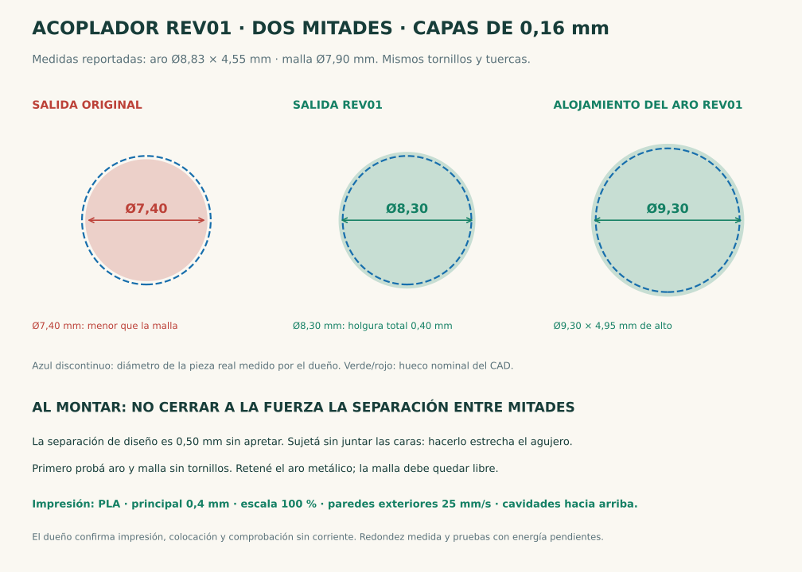

# Tip coupler REV01: measured fit and 0.16 mm layers

Reviewed November 17, 2026. The owner reports the original pair fits awkwardly and looks oval around the mesh tip. Reported measurements are metal collar **8.83 mm diameter × 4.55 mm high**, and mesh **7.90 mm maximum diameter without compression**. Printed roundness has not been independently measured.

## Replacement geometry

The original CAD exit is 7.40 mm, smaller than the reported mesh. REV01 uses a 9.30 mm diameter × 4.95 mm high collar recess and an 8.30 mm mesh exit. The collar's lower retaining shoulder stays at its original height, preserving the nominal tip position and 0.90 mm axial retaining lip. Nominal radial overlap on the measured metal collar is 0.265 mm; actual retention must be tested.

The solenoid-cap socket, two closing screw holes, three M3 nut pockets, contact-screw/wire features, 22 × 16 × 18.8 mm assembled envelope and 0.50 mm nominal split gap are preserved. CAD/mesh checks find circular surfaces, no collision with the measured collar/mesh envelopes, watertight single-body halves and no changes outside the tip cavity. STL export uses 0.005 mm linear tolerance. Digital checks do not prove printed fit or roundness.

- [Front-half STL](/downloads/ft412-coupler-rev01/FT412_Acoplador_Delantero_REV01.stl), one at 100% scale.
- [Rear-half STL](/downloads/ft412-coupler-rev01/FT412_Acoplador_Trasero_REV01.stl), one at 100% scale.
- [Revision package: both STL and STEP files, profile, license and digital checks](/downloads/ft412-coupler-rev01.zip).

## Prepared and started print

The two-part job was saved, natively sliced in Bambu Studio, and sent on the owner's explicit instruction. The matching active job was observed in initial preparation at 0/48 layers. It uses PLA, the main 0.4 mm nozzle only, nominal and first layers at **0.16 mm**, six walls, six top/bottom layers, 80% gyroid, a 3 mm outer brim and no supports or purge tower. Both open cavities face up and both objects are enabled at 100% scale. Outer/inner wall speeds are 25/45 mm/s. Slicer estimates are 1 h 15 min 24 s, 6.28 g and 2.104 m; these are not measured print results. Completion, printed roundness and physical fit remain unconfirmed.

The editable printer-specific project and authentic sliced file remain in the owner's protected preparation folder. The previously open session was backed up before loading this plate. No extra copy or second print was sent.

## Assembly trial

Follow [assembly step 25](/documentation/assembly/#paso-25-cerrar-el-acoplador-y-retener-la-punta), reusing two #7222 M3×16 closing screws and the #7218 M3×6 contact screw with three square M3 nuts. Preload the nuts while the halves are open. Try the metal collar and mesh without screws first. The collar is retained; the mesh remains free. Do not screw the tip into the plastic or solenoid.

The nominal gap before tightening is 0.50 mm. Tighten only enough to retain the cap and collar, leaving a gap. Pulling the split faces fully together narrows the bore along that axis and can make the assembly look oval. Check retention and full solenoid return with power disconnected, on a test surface before any phone contact. The reference lead and electrical tests remain separate.

These two halves replace the original pair; the machine still uses 22 installed printed pieces. The original v0.1 archive, original STL/STEP files and cradle REV01 stay unchanged. Mechanical basis: PhysiClaw by Qiao Qian, MIT; the included license notice is retained.
