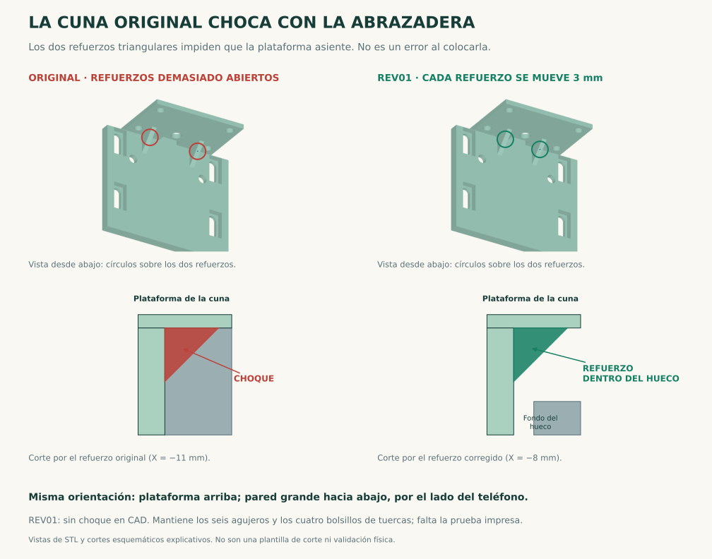

# Solenoid cradle REV01: rib interference correction

Reviewed November 17, 2026. The original FT412 cradle's two triangular ribs interfere with the belt clamp in the six-hole mounting orientation. Do not force that assembly or use the fasteners to pull the cradle into place.

REV01 moves each rib 3 mm toward the centre, from X = -11/+11 to -8/+8 mm in native CAD coordinates. The 2 mm rib thickness, triangular section, six mounting holes, four captive-nut cavities, outer dimensions and scale are preserved. The correction replaces **one cradle**, keeping 22 installed printed pieces in the machine.

## Download and status

- [Replacement STL](/downloads/ft412-cradle-rev01/FT412_Cuna_Adafruit412_REV01_Refuerzos_Corregidos.stl), quantity one, scale 100%, oriented print envelope 56 × 48 × 29 mm.
- [Editable STEP](/downloads/ft412-cradle-rev01/FT412_Cuna_Adafruit412_REV01_Refuerzos_Corregidos.step).
- [Revision package with geometry, license and digital checks](/downloads/ft412-cradle-rev01.zip).

The original cradle/STEP belt-clamp intersection is approximately 60.69 mm³; the corrected intersection is zero in CAD. Conservative envelopes for the four existing carriage screw heads also have no intersection. Each revised rib remains 2.8 mm from the belt-channel envelope. The STL is watertight, consistently wound and one connected mesh. See the included `verification.json` for hashes and checks.

**This revision is geometry only: it has not been sliced, sent or printed. Physical seating, print outcome, strength and heat/load performance remain unconfirmed.** A collision-free model is not a physical fit certificate.

## Assembly check

Follow [assembly steps 23 and 24](/documentation/assembly/#paso-23-atornillar-la-cuna-al-carro). Preload four new square M3 nuts in the cradle's four rear cavities **before** mounting it. These nuts retain the two actuator bars; they are distinct from the six nuts already installed in the belt clamp.

The short platform sits on the clamp; the wide wall hangs down on the phone side. Present without force, then use four Bolt Depot #7219 M3×8 button-head screws from above and two #7214 M3×10 countersunk screws from the front. Stop if the platform cannot seat by hand or if ribs, screw heads or belts touch. Verify both belt paths and carriage travel before fitting the actuator. Reuse the installed clamp, belts, original two bars and hardware.

The original v0.1 archive and its original STL/STEP files remain unchanged as a historical release. Use this separate replacement for the cradle. Mechanical basis: PhysiClaw by Qiao Qian, MIT; the included license notice is retained. This correction does not validate powered operation.
