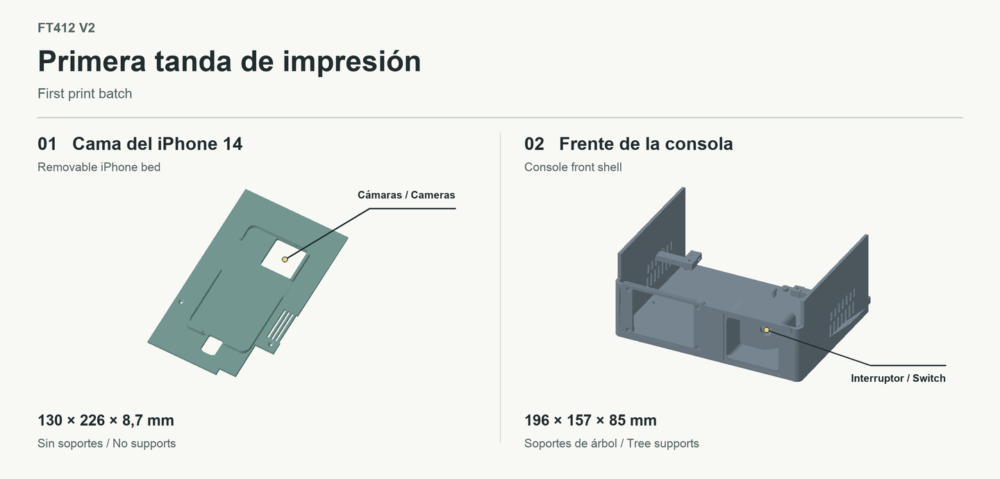

# FT412 V2 · Primera tanda de impresión / First print batch

## Español

Abrí [FT412-V2_Inicio_PETG_X2D_0.4.3mf](Bambu/FT412-V2_Inicio_PETG_X2D_0.4.3mf) en **Bambu Studio**. Elegí **Placa 1**, pulsá **Laminar placa** si la vista previa lo pide y seleccioná **Imprimir placa**. Al enviar, elegí la bobina del AMS que tenga PETG. Después de retirar la cama y limpiar la superficie, elegí la **Placa 2**.

El proyecto usa **Bambu Lab X2D, boquilla principal de 0,4 mm, PETG genérico y placa PEI texturizada**. Capas de 0,20 mm, cuatro paredes, cinco capas superiores e inferiores y borde exterior de adhesión de 5 mm. Las dos piezas están a escala 100 %. Cada placa tiene sus propios ajustes.

| Orden | Pieza | Tamaño | Relleno y soportes | Estimación de Bambu Studio |
| --- | --- | --- | --- | --- |
| 1 | [Cama del iPhone 14](Piezas/01_Cama_iPhone14.stl), una unidad | 130 × 226 × 8,7 mm | Giroide 20 %, sin soportes | 3 h 50 min · 80 g |
| 2 | [Frente de la consola](Piezas/02_Frente_consola.stl), una unidad | 196 × 157 × 85 mm | Giroide 25 %, soportes de árbol del mismo PETG | 10 h 11 min · 217 g |

Las dos impresiones suman **14 h 1 min y 297 g de PETG** según el laminador.

**Al retirar la cama**, quitá el borde de adhesión. Poné el iPhone 14 sin funda, con el vidrio hacia arriba, las cámaras sobre la ventana cuadrada y el conector Lightning hacia la abertura delantera. Presioná suavemente las esquinas por pares para comprobar que apoya sin balancearse. El diseño deja 0,30 mm por lado.

**Al retirar el frente**, quitá el borde y los soportes de árbol del hueco de la pantalla, del interruptor y de debajo de los apoyos. Las dos lengüetas finas que sujetan la Raspberry forman parte de la carcasa. La ventana de la pantalla mide 65 × 48 mm.

**Para presentar las dos piezas**, necesitás dos tornillos avellanados M3 × 8 Bolt Depot **#7213** y dos tuercas cuadradas M3. Con la ventana de pantalla hacia vos, deslizá una tuerca por detrás de cada apoyo delantero hasta alinear su rosca con el agujero vertical. Apoyá la cama y enroscá ambos tornillos desde arriba con la mano. La parte posterior de la cama se apoya en la carcasa trasera de una tanda posterior.

## English

Open [FT412-V2_Inicio_PETG_X2D_0.4.3mf](Bambu/FT412-V2_Inicio_PETG_X2D_0.4.3mf) in **Bambu Studio**. Select **Plate 1**, choose **Slice plate** if the preview requests it, then **Print plate**. Select the loaded PETG spool when sending. After removing the bed and clearing the build surface, select **Plate 2**.

The project uses a **Bambu Lab X2D, primary 0.4 mm nozzle, generic PETG and a textured PEI build plate**. Both parts use 0.20 mm layers, four walls, five top and bottom layers, a 5 mm outer brim and 100% scale.

| Order | Part | Size | Infill and support | Bambu Studio estimate |
| --- | --- | --- | --- | --- |
| 1 | One [iPhone 14 bed](Piezas/01_Cama_iPhone14.stl) | 130 × 226 × 8.7 mm | 20% gyroid, no support | 3 h 50 min · 80 g |
| 2 | One [front shell](Piezas/02_Frente_consola.stl) | 196 × 157 × 85 mm | 25% gyroid, same-material tree supports | 10 h 11 min · 217 g |

Bambu Studio estimates **14 h 1 min and 297 g of PETG** for both prints.

**Remove the bed brim.** Set the bare iPhone 14 face up, with its rear cameras over the square opening and its Lightning port facing the front cutout. Press alternate corner pairs gently to check for rocking. The design includes 0.30 mm of play per side.

**Remove the front brim and tree supports** from the display opening, switch opening and underside of the ledges. The two thin Raspberry Pi retaining clips are part of the shell. The display opening is 65 × 48 mm.

**To dry-fit the two pieces**, use two Bolt Depot **#7213** M3 × 8 countersunk screws and two square M3 nuts. Face the screen opening toward you and slide a nut into the back of each front ledge until its threads line up with the vertical hole. Set the bed on the ledges and start both screws by hand from above. The rear of the bed rests on the rear shell from a later batch.
