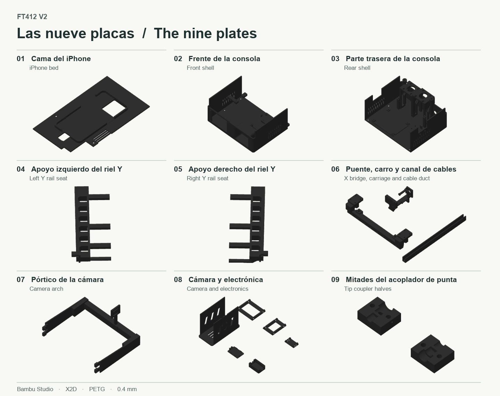

# FT412 V2 · Proyecto completo de impresión / Complete print project

[Abrir el proyecto de Bambu Studio / Open the Bambu Studio project](Bambu/FT412-V2_Completa_PETG_X2D_0.4.3mf) · [Descargar desde el sitio / Download from the website](https://livinginacat.world/downloads/ft412-v2-completa.3mf)

**¿Se soltaron las dos plaquitas de la primera placa 3?** [Reutilizá la carcasa y la plaquita izquierda](Rescate.md#español). **Did the motor plates separate on the original rear shell?** [Repair the existing print](Rescate.md#english).



## Español

Las 17 piezas, incluida la carcasa trasera R02, están a escala real en un solo archivo de nueve placas. Abrí el 3MF como **proyecto**, seleccioná la placa que querés y usá **Laminar placa** e **Imprimir placa**. Al enviar, seleccioná la bobina de PETG que tengas cargada. Si ya imprimiste la cama o el frente de la primera tanda, podés pasar directamente a la placa 3. Esas dos geometrías son idénticas a las de la primera tanda.

| Placa | Piezas | Uds. | PETG | Tiempo estimado |
| --- | --- | ---: | ---: | ---: |
| 1 | Cama del iPhone 14 y tabique | 1 | 80 g | 3 h 50 min |
| 2 | Carcasa delantera con bisel, interruptor y apoyos del Pi | 1 | 217 g | 10 h 11 min |
| 3 | Carcasa trasera con las cunas de motor, la bandeja MKS y los alojamientos de poleas | 1 | 298 g | 14 h 47 min |
| 4 | Asiento izquierdo del riel Y | 1 | 114 g | 6 h 26 min |
| 5 | Asiento derecho del riel Y | 1 | 119 g | 6 h 47 min |
| 6 | Puente X, carro del solenoide con anclajes GT2 y canal de cables | 3 | 68 g | 3 h 56 min |
| 7 | Pórtico de cámara de una pieza | 1 | 107 g | 5 h 38 min |
| 8 | Capota C922, base y tapa Adafruit, soportes Geekworm, DFRobot y portafusible | 6 | 63 g | 3 h 25 min |
| 9 | Mitades delantera y trasera del acoplador de la punta | 2 | 6 g | 0 h 45 min |

El laminador estima **1.074 g y 55 h 45 min** entre las nueve placas, incluidos los soportes y bordes de adhesión. Un rollo lleno de 1 kg queda corto. Se usó **Bambu Lab X2D, PETG genérico, boquilla principal de 0,4 mm y PEI texturizado**. Las capas nominales son de 0,20 mm en las primeras ocho placas y de 0,16 mm en el acoplador. Cada pieza tiene sus propios ajustes de paredes y relleno giroide. El borde exterior es de 5 mm.

En la **placa 3 R02**, las dos cunas llevan paredes estructurales a ambos lados. En la cuna derecha alta, los dos tornillos más cercanos a la pantalla son avellanados **#7213 M3 × 8**. Los otros seis tornillos de los motores son de botón **#7219 M3 × 8**. Así el carro puede pasar por encima de la fila delantera. La carcasa reforzada y la reparación son alternativas.

### Al armar

- **Antes de cerrar la carcasa**, cargá las tuercas cuadradas M3 de los asientos Y y de la guía X por sus ranuras laterales. Presentá los motores con sus cuatro tornillos sueltos. Las cunas traseras permiten desplazarlos hasta 2 mm en cada sentido para ajustar la tensión. Antes de apretar, comprobá que cada correa quede en su plano y que las poleas giren libres.
- **En las seis posiciones de poleas**, introducí una tuerca hexagonal M5 por la abertura lateral de cada asiento. En los cuatro soportes fijos el tornillo entra desde arriba. En los dos del puente entra desde abajo, a través de las poleas. Elegí el largo según el conjunto real de poleas y separadores. Las arandelas deben apoyar en las pistas interiores de los rodamientos.
- **En el carro**, sentá el solenoide sobre la repisa, con la varilla a través del orificio. Dos cinchos de 2,5 mm abrazan el cuerpo y la columna por los dos surcos traseros. Cada correa usa su propia altura en los postes de retorno del carro. Doblá cada extremo con los dientes enfrentados, retenelo con un cincho y dejá la cola fuera de la trayectoria de las poleas. Presentá las correas a mano antes de cortarlas. El eje de la punta queda 3,8 mm a la izquierda del centro del patín X y los ejes de las poleas móviles quedan 9 mm delante de sus posiciones en el STEP de concepto. Calibrá con la máquina montada.
- **En la electrónica**, cerrá la caja Adafruit alrededor del cableado y encajala entre las pestañas de la carcasa trasera. La parte frontal ya incluye los apoyos del Pi. Las bases ranuradas de la placa 8 permiten sujetar el soporte del Geekworm, el DFRobot y el cuerpo aislado del portafusible. Pasá los cinchos por debajo antes de pegar las bases a la cara interior del piso. Dejá accesibles los puertos y el fusible. Presentá también el canal de cables en la cara interior de la pared derecha y fijalo con cinta de montaje fina en los tramos de pared continua.
- **En la toma trasera**, el enchufe entra por el agujero central de 12 mm. La toma Kycon KPJX-PM-4S se presenta desde adentro y sus dos puntos M2,5 quedan separados 19 mm. El rebaje exterior deja 1,6 mm de material en esa zona. Verificá que la ficha de tu fuente asiente hasta el fondo cuando presentes las piezas. [Plano del fabricante](https://www.kycon.com/Pub_Eng_Draw/KPJX-PM-4S.pdf)
- **En la cámara y la punta**, el soporte conserva la altura nominal de 100 mm entre vidrio y lente. La placa 9 reutiliza la geometría REV01 para el aro de 8,83 × 4,55 mm y la malla de 7,90 mm. Retirá los bordes de adhesión antes de cerrar el acoplador. [Medidas y montaje del acoplador](../../../ft412-coupler-rev01/)

Se cotejaron las 17 mallas con el proyecto que Bambu Studio volvió a exportar después de laminar. Las nueve placas produjeron trayectorias con todas las piezas activas. En CAD se revisaron 63 posiciones del cabezal frente a las piezas fijas, incluidos los extremos de los rieles. El ajuste impreso, el guiado y agarre de las correas, la curva de los cables, la conexión de los módulos y la temperatura bajo carga requieren montaje físico. [Resultados de la verificación](verificacion.json)

## English

All 17 parts, including the R02 rear shell, are included at full scale in a single nine-plate project. Open the 3MF as a **project**, select a plate, then **Slice plate** and **Print plate**. Select your loaded PETG spool when sending. If you already printed the bed and front from batch 01, start at plate 3. The first two part geometries match that batch.

| Plate | Parts | Qty | PETG | Estimated time |
| --- | --- | ---: | ---: | ---: |
| 1 | iPhone 14 bed and service deck | 1 | 80 g | 3 h 50 min |
| 2 | Front shell with display bezel, switch recess and Pi mounts | 1 | 217 g | 10 h 11 min |
| 3 | Rear shell with motor beds, MKS mounts and fixed idler seats | 1 | 298 g | 14 h 47 min |
| 4 | Left Y rail seat | 1 | 114 g | 6 h 26 min |
| 5 | Right Y rail seat | 1 | 119 g | 6 h 47 min |
| 6 | X bridge, solenoid carriage with GT2 anchors and cable duct | 3 | 68 g | 3 h 56 min |
| 7 | Single-piece camera arch | 1 | 107 g | 5 h 38 min |
| 8 | C922 pod, Adafruit base and lid, Geekworm, DFRobot and fuse-holder mounts | 6 | 63 g | 3 h 25 min |
| 9 | Front and rear mesh-tip coupler halves | 2 | 6 g | 0 h 45 min |

Bambu Studio estimates **1,074 g and 55 h 45 min** across all nine plates, including supports and brims. A full 1 kg spool falls short. The project uses a **Bambu Lab X2D, generic PETG, the primary 0.4 mm nozzle and textured PEI**. Nominal layer height is 0.20 mm on the first eight plates and 0.16 mm for the tip coupler. Walls and gyroid infill are configured per part. The outer brim is 5 mm.

On **R02 plate 3**, both motor beds are supported on both sides. Use **#7213 M3 × 8 flat-head screws** at the two holes nearest the front display on the higher right bed. The other six motor screws are **#7219 M3 × 8 button heads**. This leaves clearance beneath the moving carriage. The integrated shell and the repair are two ways to build the same motor mounts.

### During assembly

- **Before closing the shell**, load the M3 square nuts through the side openings in the Y rail seats and X rail support. Leave the four screws on each motor loose while fitting the belts. The rear motor beds allow 2 mm of adjustment in either direction. Check both belt planes and free idler rotation before tightening.
- **At the six idler stations**, insert one M5 hex nut through the side of each seat. The axle enters from above at the four fixed stations and from below through each moving idler stack. Choose axle length against the actual stack. Spacers and shims must bear on the inner races.
- **At the toolhead**, seat the solenoid with its plunger through the shelf. Two 2.5 mm cable ties wrap the body and spine at the two rear grooves. Each belt uses its own height on the carriage anchor posts. Fold each end teeth together, secure it with a cable tie and keep the tail clear of the idlers. Route both belts by hand before cutting. The tip axis is 3.8 mm left of the X block centre. The moving idler axes are 9 mm forward of their concept STEP positions. Calibrate the assembled machine.
- **Below the deck**, close the Adafruit case around its cables and seat it in the rear shell clips. The front shell includes the Pi supports. Plate 8 supplies slotted mounts for the Geekworm stand, DFRobot and insulated fuse holder. Thread the straps before applying mounting tape beneath the feet. Keep connectors and the fuse accessible. Attach the cable duct to the inside of the right sidewall with thin mounting tape on the continuous wall sections.
- **At the rear power port**, the plug enters through a 12 mm centre aperture. Fit the Kycon KPJX-PM-4S from inside. Its two M2.5 fasteners are 19 mm apart. The outside recess leaves a 1.6 mm panel at the socket. Check full plug seating with your parts. [Manufacturer drawing](https://www.kycon.com/Pub_Eng_Draw/KPJX-PM-4S.pdf)
- **At the camera and tip**, the mount retains the nominal 100 mm glass-to-lens distance. Plate 9 uses the REV01 coupler geometry for the 8.83 × 4.55 mm collar and 7.90 mm mesh. Remove the brims before closing the coupler. [Coupler dimensions and assembly](../../../ft412-coupler-rev01/)

All 17 meshes were compared with the Bambu Studio re-export after slicing. Every enabled object produced toolpaths. The CAD check compared the head with fixed components at 63 positions, including the rail ends. Printed fit, belt routing and grip, dynamic cable clearance, connector access and thermal performance still need a physical build. [Verification results](verificacion.json)

### Regenerar / Rebuild

Desde la raíz del repositorio / From the repository root:

```sh
src=hardware/ft412-v2/Fabricacion/02-Proyecto-completo-R01
work=$(mktemp -d)
uv run --python 3.12 --script "$src/Fuente/geometria.py" "$work/meshes"
uv run --python 3.12 --script "$src/Fuente/proyecto.py" "$work/meshes"
uv run --python 3.12 --script "$src/Fuente/recorrido.py"
mkdir -p "$work/native"
"/Applications/BambuStudio.app/Contents/MacOS/BambuStudio" --arrange 0 --orient 0 --slice 0 \
  --outputdir "$work/native" --export-3mf FT412-V2_Completa_PETG_X2D_0.4.3mf \
  "$src/Bambu/FT412-V2_Completa_PETG_X2D_0.4.3mf"
uv run --python 3.12 --script "$src/Fuente/proyecto.py" "$work/meshes" \
  --native "$work/native/FT412-V2_Completa_PETG_X2D_0.4.3mf"
```

Para regenerar la reparación desde la misma raíz / To rebuild the repair from the same root:

```sh
uv run --python 3.12 --script "$src/Fuente/rescate.py" "$work/repair"
uv run --python 3.12 --script "$src/Fuente/proyecto.py" "$work/repair" \
  --layout "$src/rescate.json" --output "$src/Bambu/FT412-V2_Rescate_Placa03_PETG_0.4.3mf"
uv run --python 3.12 --script "$src/Fuente/trayectorias_motor.py" "$work/native/plate_3.gcode"
```

[Manifiesto de piezas / Part manifest](placas.json) · [CAD de referencia / Reference CAD](../../Consola-tornilleria/) · [Licencia del acoplador / Coupler license](../../../ft412-coupler-rev01/LICENSE)
