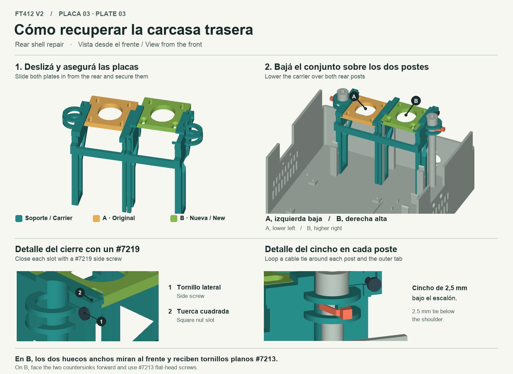

# Reparar la placa 3 / Repair plate 3

[Proyecto Bambu de reparación / Bambu repair project](Bambu/FT412-V2_Rescate_Placa03_PETG_0.4.3mf) · [Proyecto completo actualizado / Updated complete project](Bambu/FT412-V2_Completa_PETG_X2D_0.4.3mf)

## Español

Esta reparación sirve cuando las dos placas planas de los motores salieron con los soportes y la carcasa trasera R01 quedó entera, con sus dos postes de polea. En esa primera versión, cada plaquita tocaba solo unos **17 mm²** de material permanente en un solo borde. El soporte nuevo apoya cada placa por los dos lados y transmite la carga al piso. El montaje es reversible.

**Prepará estas piezas**

| Pieza | Cantidad | Dónde va |
| --- | ---: | --- |
| Carcasa trasera R01 y una plaquita original | 1 de cada una | La plaquita se usa en el lado izquierdo bajo (A). Guardá la segunda como repuesto. |
| Soporte doble y plaquita B con dos avellanados | 1 de cada una | Ambas se imprimen juntas en el 3MF de reparación. PETG, boquilla de 0,4 mm. Estimación de Bambu Studio: 59 g y 3 h 38 min. |
| #7219 M3 × 8, cabeza de botón | 8 | Cuatro para el motor A, dos atrás del motor B y dos para cerrar las entradas laterales del soporte. |
| #7213 M3 × 8, cabeza plana | 2 | Los dos huecos anchos del frente del motor B. |
| Tuerca cuadrada M3 | 2 | Una en cada bolsillo del soporte, para los dos tornillos de cierre. |
| Cincho de 2,5 mm de ancho | 2 | Uno por poste trasero. |
| Llave Allen de 2 mm | 1 | Para ambos tipos de tornillo. |

1. **Orientá el soporte sobre la mesa.** Mirando desde el frente de la máquina (el lado de la pantalla), A queda abajo a la izquierda y B queda 7 mm más arriba a la derecha. Retirá el brim y el material de soporte de las guías y los dos bolsillos para tuerca.
2. **Deslizá las placas desde atrás.** Poné la original en A y la nueva en B. Los dos huecos en forma de embudo de B quedan arriba, hacia el frente. Empujá cada plaquita hasta su tope delantero.
3. **Cerrá las dos entradas.** En cada esquina trasera, dejá caer una tuerca cuadrada de canto en la ranura superior. Desde la cara exterior, meté un #7219 y enroscalo en esa tuerca. Su punta cruza detrás del canto de la plaquita. Probá con los dedos que ninguna pueda salir hacia atrás.
4. **Montá los motores sobre la mesa.** El cuerpo de cada motor queda debajo de su placa y el eje sale hacia arriba. A lleva cuatro #7219. B lleva dos #7219 atrás y dos #7213 adelante. Dejá los tornillos apenas sujetos para ajustar las correas al final. Las dos cabezas planas deben quedar a ras o por debajo del plástico.
5. **Bajá el conjunto sobre la carcasa.** Las dos aberturas redondas del soporte rodean los postes de las poleas traseras. Si ya instalaste las poleas, retirá primero sus ejes y arandelas conservando el orden. Los pies del soporte deben tocar el piso y la entrada de alimentación debe seguir accesible.
6. **Sujetá el soporte.** En cada extremo, pasá un cincho alrededor de la parte angosta del poste original y de la pequeña pestaña vertical del soporte. Debe quedar **debajo del escalón ancho** del poste. Dejá la cabeza del cincho hacia afuera. Reinstalá las poleas si las retiraste.
7. **Antes de tensar las correas**, comprobá a mano que el soporte no bascule ni pueda levantarse, que cada motor pueda deslizarse en sus cuatro ranuras y que el carro pase sobre los tornillos del motor derecho en todo el recorrido. Ajustá la tensión y repetí el recorrido a mano.

El encaje, la altura de los planos de correa y el recorrido se comprobaron en CAD. El ajuste de las piezas impresas y la rigidez bajo tensión quedan por comprobar en la máquina. [Verificación de geometría y laminado](verificacion-rescate.json) · [#7213 de Bolt Depot](https://boltdepot.com/Product-Details?product=7213) · [#7219 de Bolt Depot](https://boltdepot.com/Product-Details?product=7219)

## English

Use this repair when both motor plates came away with the print supports and the R01 rear shell and its two rear idler posts are intact. The original CAD joined each plate along one edge over about **17 mm²**. The new carrier supports both sides and transfers the load to the shell floor. It can be removed for service.

| Part | Qty | Use |
| --- | ---: | --- |
| Original R01 rear shell and one loose motor plate | 1 each | Reuse the plate at the lower left (A). Keep the other as a spare. |
| Twin carrier and countersunk right plate B | 1 each | Print together from the repair 3MF. PETG with a 0.4 mm nozzle. Bambu Studio estimate: 59 g and 3 h 38 min. |
| #7219 M3 × 8 button-head screw | 8 | Four for motor A, two at the rear of motor B and two side screws to close the carrier slots. |
| #7213 M3 × 8 flat-head screw | 2 | Two countersinks at the front of motor B. |
| M3 square nut | 2 | One per carrier slot screw. |
| 2.5 mm wide cable tie | 2 | One per rear post. |
| 2 mm hex key | 1 | Fits both screw types. |

1. **Orient the carrier on the bench.** Viewed from the front display, A is on the lower left and B is 7 mm higher on the right. Remove the brim and print support from the rails and the two square-nut pockets.
2. **Slide both plates in from the rear.** Put the original on the left. Put the new B plate on the right with the two countersunk slots facing up and toward the front display. Push each plate forward to its stop.
3. **Lock the slots.** At each rear corner, drop a square nut edge-first into the top slot. Drive a #7219 screw from the outer face into the nut. Its tip crosses behind the plate edge. Pull gently on both plates to check that they cannot slide out.
4. **Mount both motors on the bench.** Motor bodies go under the plates with shafts pointing up. Use four #7219 screws on A. Use two #7219 at the rear and two #7213 at the front on B. Leave them finger-tight for belt adjustment. Both flat heads must sit flush with or below the plastic.
5. **Lower the assembly into the shell.** The two rings fit over the existing rear idler posts. If the idlers are already fitted, remove their axles first and keep their washers in order. Seat the feet against the floor and check access to the power inlet.
6. **Secure each end.** Wrap one cable tie around the narrow neck of the original post and the small outer vertical tab of the carrier, **below the wider shoulder**. Place each tie head outboard. Reinstall the idlers if removed.
7. **Before tensioning the belts**, check that the carrier sits flat, resists lifting, and that both motors slide along their slots. Move the carriage by hand over both front screw heads on the right motor. Set the belt tension and repeat the manual travel check.

Fit, belt elevations and travel were checked in CAD. Printed fit and stiffness under belt load still need physical verification. [Geometry and slicing verification](verificacion-rescate.json) · [Bolt Depot #7213](https://boltdepot.com/Product-Details?product=7213) · [Bolt Depot #7219](https://boltdepot.com/Product-Details?product=7219)
