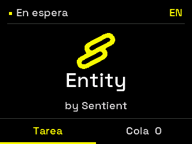

# Pantalla MKS / MKS display

## Español

Al encender la MKS aparece el logo de Sentient. En reposo, la pantalla muestra **Entity by Sentient**. Cuando la Raspberry inicia una tarea, aparecen su título, la acción en curso y la próxima tarea si la hay. Al terminar, vuelve el logo. **Cola** muestra tres tareas por página. Tocá las flechas para recorrerlas y **Tarea** para volver. **EN** cambia el idioma. Los títulos conservan el idioma en que los escribiste.

Los controles de la pantalla sirven para consultar las tareas. Si la Raspberry pierde la conexión, el encabezado indica **Sin conexión**. [Ver el panel desde la Mac](https://entity.livinginacat.world/entity/?lcd=1&lang=es) · [Firmware y recuperación](../firmware/entity-panel/README.md).

## English

The Sentient mark appears when the MKS powers up. The idle screen shows **Entity by Sentient**. When the Raspberry Pi starts a task, the display shows its title, current action and next queued task, if any. The logo returns when the task ends. Tap **Queue** to see three tasks per page. Use the arrows to browse and **Task** to return. **ES** changes the language. Task titles keep their original wording.

The touchscreen controls let you browse tasks. The header shows **Offline** if the Raspberry Pi disconnects. [Open the panel from the Mac](https://entity.livinginacat.world/entity/?lcd=1&lang=en) · [Firmware and recovery](../firmware/entity-panel/README.md).
